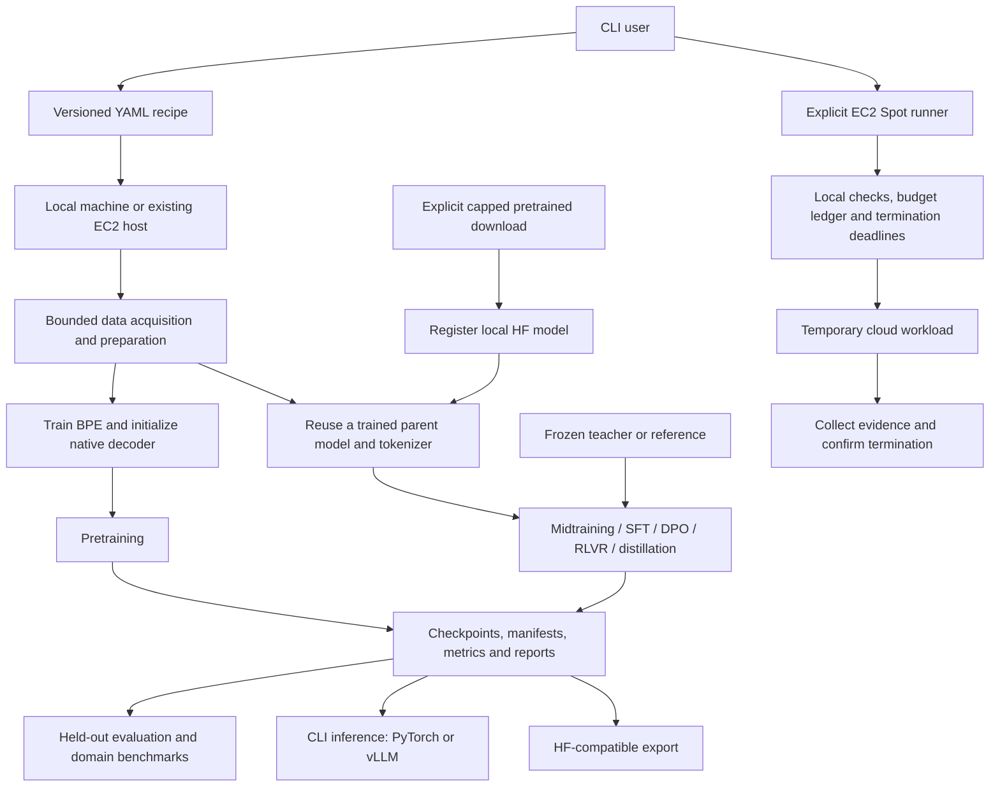
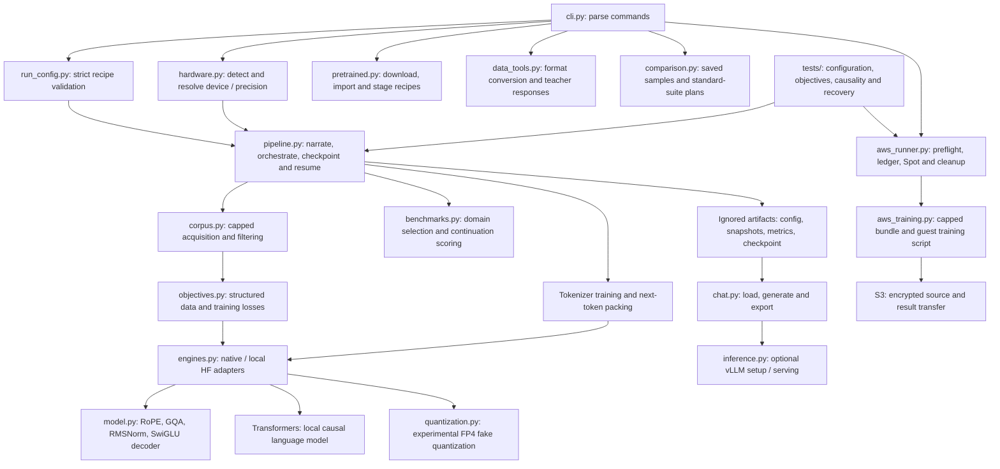

# AshayLLM

Imagine building an offline study buddy, a game character with its own voice, a personal writing assistant, a code explainer, or a finance-news summarizer. AshayLLM provides the model experimentation tools for these future projects; useful application quality will depend on suitable data, training and evaluation.

AshayLLM is a configurable language-model experimentation workbench: acquire bounded corpus samples, prepare data, train a custom tokenizer, pretrain a decoder-only transformer, evaluate it and interact with its trained checkpoints. One Python/PyTorch codebase supports local development and cloud execution, with a separate budget-controlled EC2 Spot smoke-test runner.

**Available workflows:** hardware-aware setup; bounded data acquisition and preparation with filtering, deduplication, PII heuristics and sampled benchmark decontamination; custom byte-level BPE training; from-scratch pretraining; checkpoint recovery; midtraining, response-masked SFT, DPO, experimental verifiable-reward training and distillation; capped pretrained-model acquisition/import; domain-selected sample benchmarks, local baseline comparisons and an optional standard evaluation harness; Hugging Face-compatible export; CLI inference through PyTorch or optional vLLM; and budget-controlled EC2 Spot smoke tests and S3-backed native training stages.

Local CPU/CUDA checks exercise the training paths; live AWS training, full standard suites, macOS hardware and native Blackwell FP4 still require separate validation.

## Choose where to run

### Serve a trained checkpoint as a secure API

Serving runs on the machine where you invoke it: a prepared Linux/WSL CUDA laptop, an existing EC2 host, or another compatible vLLM host. It does not provision a machine. Keep the process running while clients use it; AWS running costs continue for the lifetime of the host.

1. Export a completed run: `python -m ashayllm.cli export RUN_DIR`. Use the printed export directory as `inference.model_path`. Install the optional vLLM environment using the setup instructions below.
2. Obtain a trusted TLS certificate for the hostname clients will use. Keep its full certificate chain and private key outside Git, restrict the private key's file permissions, and put their paths in a copy of `configs/inference-public.yaml`, named `configs/inference-public.local.yaml`. Do not disable certificate verification on clients.
3. Set `ASHAYLLM_API_KEY` in the serving process environment to a cryptographically random token of at least 32 characters. For example, generate a token with `python -c 'import secrets; print(secrets.token_urlsafe(48))'` and load it through your secret manager or a private environment file. Do not put the token in YAML, shell command arguments, Git or shared logs. All clients holding this token share access; rotate it by changing the environment and restarting the server.
4. Preview: `python -m ashayllm.cli serve-vllm configs/inference-public.local.yaml`. Then start: `python -m ashayllm.cli serve-vllm configs/inference-public.local.yaml --run`. The default local config binds loopback; the public example binds port 8443 with TLS. A missing token or missing TLS files prevents startup. Plans contain the secret's variable name, never its value.
5. Allow inbound TCP 8443 only from intended client networks in your host firewall and, on EC2, its security group. For a laptop, WSL/Windows forwarding and your router or VPN must make that port reachable. The code does not open firewall rules or router ports. Prefer a private VPN for a small group.
6. Clients send `Authorization: Bearer <token>` to `https://YOUR_HOSTNAME:8443/v1/models` or POST text requests to `/v1/completions` and `/v1/chat/completions`. For example, a completions body is `{"model":"artifacts/exports/ashayllm","prompt":"Explain gravity","max_tokens":64}`; use the model ID returned by `/v1/models`. Chat requires a suitable model chat template and instruction training; a base checkpoint can use completions.

The middleware in `src/ashayllm/api_security.py` authenticates every exposed HTTP request and blocks all routes except these three, including administrative routes and alternate inference paths. It enforces bounded request bodies, process-wide rate/concurrency limits, timeouts, and text-only inputs; request prompt logging and interactive API docs are disabled. TLS files and tokens stay local. Native vLLM API keys alone do not cover all routes; see the [vLLM serving security guidance](https://docs.vllm.ai/en/latest/cli/serve/).

These controls are a secure starting point, not a guarantee of complete security. This mode supports one API process and a shared token; it does not provide individual identities, billing quotas, distributed rate limits, or protection against network-level denial of service. For public multi-user production access, place it behind a managed gateway with identity, quotas and network protection, keep the backend private, and review the deployment. No public endpoint is opened automatically.


### Custom CUDA and execution settings

Custom CUDA is opt-in for the native decoder. The included example replaces the SwiGLU activation with a CUDA extension implementing both forward and backward operations. PyTorch remains the default. This is a correctness-oriented example; no speedup has been established.

1. Use a Linux CUDA host or WSL2 with a working NVIDIA driver, C++ compiler and a CUDA toolkit compatible with your installed PyTorch. The toolkit's `nvcc` and runtime headers must also match. CPU and Apple MPS cannot execute this extension.
2. Install the small build dependency in your active environment: `python -m pip install -e '.[cuda-kernels]'`. If the toolkit is outside standard locations, set `CUDA_HOME` to its root. This command does not install a CUDA toolkit.

   For the project's Linux x86-64 PyTorch CUDA **13.0** environment, compatible compiler components are available through `python -m pip install -e '.[cuda-kernels,cuda13-toolchain]'`. This pins `nvidia-cuda-nvcc`, `nvidia-cuda-crt` and `nvidia-nvvm` to 13.0.88; it does not replace PyTorch's runtime. Set the toolkit root for these wheels with `export CUDA_HOME="$(python -c 'import site; print(site.getsitepackages()[0])')/nvidia/cu13"`. Use a matching toolkit instead if your PyTorch build uses another CUDA version.
3. Run the forward/gradient check before training:

   ```bash
   python -m ashayllm.cli check-cuda-kernel kernels/swiglu
   ```

4. Start with `configs/pretrain-custom-cuda.yaml`, or copy your training recipe and edit the following fields within its existing sections:

   ```yaml
   model:
     custom_swiglu_path: kernels/swiglu
     attention_kernel: auto
   training:
     accelerator: cuda
     precision: bf16
     compile: false
     optimizer_kernel: default
     allow_tf32: false
   ```

5. Run `python -m ashayllm.cli pipeline configs/YOUR_RECIPE.yaml --run`. Startup validates FP32, FP16 and supported BF16 outputs and gradients against PyTorch before acquiring data. Source hashes are recorded and checked when resuming. Build products stay under ignored `artifacts/cuda-extensions/`.

`src/ashayllm/execution.py` loads the trusted local plugin and runs checks; `model.py` selects it; `kernels/swiglu/kernel.py` provides the autograd wrapper; `swiglu.cpp` exposes bindings; and `swiglu.cu` implements the CUDA operations. Your own directory must export `swiglu(gate, up)` from `kernel.py` with autograd support. Selecting a plugin executes its local code, so use a source directory you trust. Set `custom_swiglu_path: null` to restore the built-in activation.

Other optional execution controls are `model.attention_kernel: auto|math|flash|efficient|cudnn`, `training.compile`, `compile_backend: inductor|aot_eager|eager`, `compile_mode: default|reduce-overhead|max-autotune`, and `optimizer_kernel: default|fused|foreach`. Explicit optimized attention and fused optimizer selections require a compatible GPU. Measure throughput and memory for your workload; compilation can add startup time. Custom CUDA is currently limited to native-model SwiGLU and prepared hosts; managed `aws-train` packaging rejects it. Native FP4 kernels are a separate capability.

The included kernel has passed FP32, FP16 and BF16 forward/backward checks on an RTX 4060 Laptop GPU with CUDA 13.0 compiler components. NVIDIA runtime wheels that lack an unversioned `libcudart.so` receive a linker alias inside the ignored build directory. A mismatched toolkit still fails visibly rather than bypassing compatibility checks. These checks establish correctness for the tested inputs, not a performance improvement.

### Optional reasoning supervision

Reasoning supervision defaults to `stage.reasoning_format: plain`. For SFT or distillation, select `think_answer` and supply JSONL records with `prompt`, `reasoning` and `answer` fields. The prepared response contains `<think>…</think>` followed by `<answer>…</answer>`. Allocate enough context for both sections. This trains the supplied explanation format; it does not establish reasoning quality. With verifiable-reward training, the optional format checks the final answer inside a single answer tag.


### High-level architecture



The local pipeline runs where invoked; it does not choose or provision AWS automatically. Run artifacts and downloaded models remain outside Git. Post-training objectives and pretrained import/SFT/export are covered by small CPU tests, with native stages also exercised on CUDA. Real-device macOS, live AWS training and native FP4 validation require their respective environments.

### Low-level component map



| Code | Responsibility |
| --- | --- |
| `cli.py`, `run_config.py` | Command dispatch and strict, versioned configuration |
| `hardware.py`, `engines.py` | Backend selection and native/local pretrained model adapters |
| `corpus.py` | Bounded source snapshots, quality/PII/dedup/decontamination heuristics and document splits |
| `pipeline.py` | Stage explanations, BPE/packing, optimizer loop, checkpoints, recovery and run reports |
| `model.py` | Custom decoder implementation used for from-scratch experiments |
| `objectives.py` | Response masking, DPO reference likelihoods, verifiable-reward rollouts and teacher KL |
| `pretrained.py` | Explicit capped model download, local import and parent-derived stage recipes |
| `data_tools.py` | Bounded text/CSV/JSONL conversion and local teacher-response generation |
| `comparison.py` | Local baseline comparisons and optional standard-suite execution plans |
| `quantization.py` | Software FP4 simulation with straight-through gradients; no packed-weight acceleration |
| `execution.py`, `kernels/swiglu/` | Attention/compiler policy, custom CUDA source verification and differentiable SwiGLU extension |
| `api_security.py` | vLLM route authentication, text-only request checks and process-wide resource limits |
| `benchmarks.py` | Domain benchmark acquisition and custom sampled evaluation protocol |
| `chat.py`, `inference.py` | Checkpoint inference, exports and optional vLLM serving |
| `aws_runner.py` | Local preflight, conservative budget reservations, Spot lifecycle and shutdown safeguards |
| `aws_training.py` | Allowlisted training bundles, local data/training preflight, source verification and bounded result upload |
| `tests/` | Small unit/integration tests; hardware availability determines device coverage |

| Goal | Where execution happens | What to run | AWS required? |
| --- | --- | --- | --- |
| Pretrain on a bounded corpus sample | Current machine (local or an existing EC2 host) | `pipeline CONFIG --run` | No automatic provisioning |
| Talk to a trained checkpoint | Current machine | `chat RUN_DIR` | No |
| Export trained weights | Current machine | `export RUN_DIR` | No |
| Check your laptop/desktop GPU | Current machine | `doctor`, `resolve-runtime`, `smoke` | No |
| Develop code and run unit tests | Current machine | `python -m pytest -q`, `python -m ruff check .` | No |
| Install PyTorch or vLLM | Current machine | `setup --apply`, `setup-vllm --apply` | No |
| Serve an existing local model export | Current Linux/WSL CUDA machine | `serve-vllm ... --run` | No |
| Preview an EC2 test | Local controller makes read-only AWS requests | `aws-test` | Credentials, but no instance launched |
| Provision and test a cloud GPU | Local controller launches a temporary EC2 instance; tests run there | `aws-test ... --run` | Yes; incurs AWS charges |
| Recover cloud results/cleanup | Local controller queries AWS and removes temporary resources after termination | `aws-reconcile` | Yes; no new instance launched |

Commands run **where you invoke them**. If you SSH into an existing EC2 instance and run `doctor`, it inspects that EC2 instance. It does not provision another machine. `aws-test --run` and `aws-train CONFIG --run` explicitly launch temporary Spot compute.

`configs/local.yaml` and `configs/aws.yaml` describe runtime/model planning settings. Selecting `aws.yaml` does **not** deploy anything. `configs/aws-test.yaml` is the separate EC2 provisioning/budget configuration.

## Tutorial roadmap

1. Clone the repository and create a local development environment.
2. Select and verify local hardware/precision.
3. Optionally install and test inference.
4. Set up AWS CLI credentials and IAM permissions.
5. Preview, launch and verify a budget-controlled Spot test.
6. Inspect results and recover interrupted runs.

Run all project commands from the repository root. After installing the package, `ashayllm COMMAND` and `python -m ashayllm.cli COMMAND` are equivalent; this guide uses the second form to make the Python environment explicit.

## 1. Install locally

### Windows with an NVIDIA GPU: prepare WSL2

Use the Windows NVIDIA driver. Do not install a Linux NVIDIA display driver inside WSL. See the [NVIDIA WSL guide](https://docs.nvidia.com/cuda/wsl-user-guide/index.html).

In Windows PowerShell:

```powershell
nvidia-smi
wsl --status
wsl --list --verbose
# Only if Ubuntu is not already installed; installation may require administrator rights.
wsl --install -d Ubuntu-24.04
```

Restart if requested, open Ubuntu, and create your normal Linux user. Verify Ubuntu internet access before installing packages:

```bash
curl --connect-timeout 10 --max-time 15 -I https://pypi.org
nvidia-smi
```

Docker is optional; it is not required for the CLI or Spot runner.

### Linux/WSL: clone and create the development environment

Install Git, a C compiler and curl using your distribution's package manager. On Ubuntu:

```bash
sudo apt update
sudo apt install -y git curl build-essential
curl -LsSf https://astral.sh/uv/install.sh | sh
export PATH="$HOME/.local/bin:$PATH"
mkdir -p ~/projects
cd ~/projects
git clone https://github.com/ashaytamhane/ashayllm.git
cd ashayllm
uv venv --python 3.12
source .venv/bin/activate
uv pip install -e '.[dev,pipeline]'
python -m ashayllm.cli --help
python -m pytest -q
python -m ruff check .
```

The repository is private, so GitHub authentication is needed to clone it. Keep WSL working files on the Linux filesystem rather than under `/mnt/c` for development performance. Installation downloads software packages, not training corpora or pretrained models. See [uv installation](https://docs.astral.sh/uv/getting-started/installation/) for other platforms.

### Windows-only controller or CPU development

A Windows controller does not need PyTorch or a GPU to launch AWS tests. With Python 3.12 and Git installed:

```powershell
git clone https://github.com/ashaytamhane/ashayllm.git
cd ashayllm
py -3.12 -m venv .venv-aws
.\.venv-aws\Scripts\Activate.ps1
python -m pip install -e '.[dev,aws]'
python -m ashayllm.cli --help
python -m pytest -q
```

If PowerShell activation is unavailable, invoke `.\.venv-aws\Scripts\python.exe` directly instead of `python`. Local GPU inference through the automatic vLLM setup requires Linux/WSL NVIDIA CUDA.

### macOS: Apple Silicon or Intel MacBook

macOS runs the same Python codebase directly; WSL and CUDA are not required. The hardware detector selects PyTorch's MPS backend when available, otherwise CPU. Automatic precision selection uses FP32 on both. macOS setup paths exist, but a complete run has **not yet been validated on a real MacBook**.

Install Git and `uv` using your preferred method, then run these commands in Terminal. The repository requires GitHub authentication:

```bash
git clone https://github.com/ashaytamhane/ashayllm.git
cd ashayllm
uv venv --python 3.12
source .venv/bin/activate
uv pip install -e '.[dev,pipeline]'
# Preview the macOS PyTorch installation before applying it.
python -m ashayllm.cli setup
python -m ashayllm.cli setup --apply
python -m ashayllm.cli doctor
python -m ashayllm.cli smoke --precision fp32
python -m pytest -q
```

Check `doctor` for `backend: mps` and `mps_available: true` to confirm GPU availability. An Apple Silicon Mac can use MPS when its OS and PyTorch build support it; Intel Macs can use CPU and may expose MPS on supported GPUs. If an operation fails on MPS, verify the CPU path explicitly:

```bash
python -m ashayllm.cli smoke --accelerator cpu --precision fp32
```

To preview and then execute a bounded pretraining run on the Mac itself:

```bash
python -m ashayllm.cli pipeline configs/pretrain-local.yaml
# This downloads the configured small corpus/benchmark samples and trains locally.
python -m ashayllm.cli pipeline configs/pretrain-local.yaml --run
```

The recipe's `training.accelerator: auto` selects the available backend. To force CPU training, copy the recipe and set `training.accelerator: cpu` and `training.precision: fp32`. Reduce model dimensions, context length or microbatch size if memory is insufficient; hardware detection does not automatically resize the model.

After training, replace `PATH_TO_COMPLETED_RUN` with the run directory printed by the pipeline:

```bash
python -m ashayllm.cli chat PATH_TO_COMPLETED_RUN --backend torch
```

The CLI supports `/reset` and `/exit`. A short training test produces limited text quality; SFT support does not make a tiny validation model a useful assistant. Use the PyTorch backend on macOS: the project's automatic vLLM installation targets Linux/WSL with NVIDIA CUDA. A Mac can also act as an AWS controller after installing `.[aws]` and following the AWS sections below.

### Hardware support and validation

| Environment | Training / PyTorch CLI inference | Automatic precision | Validation status |
| --- | --- | --- | --- |
| NVIDIA CUDA on Linux/WSL | CUDA | BF16 when reported supported; otherwise FP32 | Local CUDA pretraining and checkpoint/inference checks exercised |
| macOS with available MPS | Apple GPU through MPS | FP32 | Detection/setup implemented; real MacBook validation pending |
| CPU, including Intel Macs | CPU | FP32 | Small CPU pipeline and checkpoint tests exercised; not validated on macOS hardware |
| Compatible AMD GPU on Linux | ROCm | BF16 when reported supported; otherwise FP32 | Detection/setup implemented; real-device validation pending |

The automatic vLLM installer supports Linux/WSL NVIDIA CUDA only. Backend detection establishes availability, not compatibility of every operation or a guarantee that the configured model fits in memory.

## 2. Select and verify local hardware

Creating the base environment does not install PyTorch. First preview the installation:

```bash
python -m ashayllm.cli setup
# Or deliberately choose a CPU-only environment:
python -m ashayllm.cli setup --backend cpu
```

Review the detected backend, driver and proposed command. Install into the active environment only when ready:

```bash
python -m ashayllm.cli setup --apply
python -m ashayllm.cli doctor
python -m ashayllm.cli check-config configs/local.yaml
python -m ashayllm.cli resolve-runtime configs/local.yaml --output artifacts/environment/resolved-local.json
python -m ashayllm.cli smoke
```

Expected results: `doctor` describes the available backend; on CUDA it also checks matrix multiplication. `smoke` reports `training_step: passed` and `checkpoint_recovery: passed`. These are synthetic checks, not language-model training or throughput measurements.

The default stack pins PyTorch 2.13.0 and NumPy 2.3.5. The default CUDA 13.0 installation plan requires NVIDIA driver major version 580 or newer. Setup installs packages, not drivers or OS prerequisites. For another GPU/driver combination, select an appropriate official build with `--torch-version` and `--index-url`; check the [PyTorch installation selector](https://pytorch.org/get-started/locally/). ROCm setup needs an explicit compatible wheel index; MPS requires macOS. Those backends still need real-device validation.

### Precision and memory

| Setting | Behavior |
| --- | --- |
| `accelerator: auto` | Available CUDA/ROCm, then MPS, otherwise CPU |
| `precision: auto` | BF16 when PyTorch reports support on CUDA/ROCm; otherwise FP32 |
| `fp16` | Explicit CUDA/ROCm training with gradient scaling |
| `fp32` | Default fallback; useful for CPU checks |
| FP4 simulation | `model.quantization: fp4_fake`; experimental software fake quantization with FP32/BF16 master weights |
| Native NVFP4 inference | `inference.quantization: nvfp4_per_token`; supported Blackwell CUDA hardware and vLLM required |

BF16 reporting can include emulated support; it does not establish native acceleration or performance. Explicit unavailable backends/precision fail rather than silently switching. Microbatch defaults to 1; automatic model-specific memory calibration is pending.

Examples:

```bash
# Debug checkpoint behavior without using the GPU.
python -m ashayllm.cli smoke --accelerator cpu --precision fp32
# Check mixed-precision training on your current CUDA machine.
python -m ashayllm.cli smoke --accelerator cuda --precision fp16
```

## 3. Optional local inference with vLLM

Use the Linux/WSL `.venv` from step 1, a compatible NVIDIA GPU/driver, and a C compiler:

```bash
python -m ashayllm.cli setup-vllm
python -m ashayllm.cli setup-vllm --apply
python scripts/vllm_smoke.py
```

The installer targets `.venv` in the project root and pins vLLM 0.31.0 with the shared PyTorch/CUDA stack. The smoke script generates from tiny random local weights; it does not test a useful trained language model. Other inference backends need their own [vLLM installation recipe](https://docs.vllm.ai/en/latest/getting_started/installation/gpu/).

To serve an existing compatible Hugging Face export, set `inference.model_path` in `configs/inference.yaml` to a local directory containing `config.json`, `tokenizer.json` and safetensors or `pytorch_model.bin` weights:

```bash
python -m ashayllm.cli serve-vllm configs/inference.yaml
python -m ashayllm.cli serve-vllm configs/inference.yaml --run
```

The first command validates files and prints a plan. The second starts foreground serving at `http://127.0.0.1:8000/v1`. Stop it with Ctrl+C. Downloads and remote model code are disabled. A `.pt` checkpoint alone is insufficient; use `export RUN_DIR` to create the compatible model directory. Default memory utilization is 50%, context 2048 and concurrency 4; adjust for your model, and avoid simultaneous training/serving on a small GPU.

## 4. Prepare AWS access

Skip this entire section for local-only work. AWS commands run from your **controller** environment: Windows, WSL or Linux. Use the same environment for credentials and the runner; Windows and WSL normally have separate AWS profile files.

### 4.1 Install AWS CLI and the controller dependencies

Install [AWS CLI v2](https://docs.aws.amazon.com/cli/latest/userguide/getting-started-install.html), reopen your terminal, and check:

```bash
aws --version
python -m pip install -e '.[dev,aws]'
```

The controller needs pytest and Ruff for automatic local preflight; it does not need local CUDA. Keep your controller terminal open while the run proceeds.

### 4.2 Set up the caller identity and permissions

There are two identities:

| Identity | Responsibility |
| --- | --- |
| Your configured CLI profile | Discover images/prices/subnets, provision EC2, monitor results, manage temporary schedules and clean up |
| `ashayllm-spot-deadline` scheduler role | Permit AWS Scheduler to terminate project-tagged instances at the deadline |

Use an IAM administrator for one-time permission setup. Do not use root access keys or put `AdministratorAccess` on the everyday controller just to avoid configuring permissions.

For an IAM user workflow:

1. In AWS Console, open **IAM > Users > Create user** and create a dedicated controller user, such as `ashayllm-controller`. Console access is unnecessary for CLI-only use.
2. Generate a baseline permission policy from the current AWS runner rather than relying on a stale copied policy. With uv installed, use the command below. It analyzes code; it does not launch EC2 or attach policies.
3. Have the administrator review the generated policies, replace wildcard resources where feasible with your account/region/project resources, and validate them in IAM. Static analysis is a starting point: dynamically constructed service clients, paginator/waiter operations and dependent permissions need review.
4. In **IAM > Policies > Create policy > JSON**, create the reviewed customer-managed policy or policies. Attach them to the controller user (or its group/role). Regenerate/review when AWS runner behavior changes.
5. Decide whether the controller may create the scheduler role on first use, or whether the administrator will pre-create it with the exact name and trust/termination policy described below.

From the repository root on Linux/WSL, replace `YOUR_ACCOUNT_ID` with your account ID:

```bash
uvx iam-policy-autopilot@latest generate-policies \
  "$PWD/src/ashayllm/aws_runner.py" \
  --region us-east-1 --account YOUR_ACCOUNT_ID \
  --service-hints ec2 iam scheduler ssm sts --pretty
```

See [AWS IAM Policy Autopilot](https://github.com/awslabs/iam-policy-autopilot) for supported inputs and policy review guidance. PowerShell uses `(Resolve-Path src/ashayllm/aws_runner.py).Path` for the source path and backticks for line continuation, or place the command on one line.

The administrator must cover EC2 discovery, Spot launch/tagging, security-group creation/deletion, console retrieval and termination, including operations used by waiters. Scheduler access covers the `ashayllm` group and its run schedules. Passing the role needs `iam:PassRole` restricted to `arn:aws:iam::YOUR_ACCOUNT_ID:role/ashayllm-spot-deadline` and `iam:PassedToService = scheduler.amazonaws.com`; see [AWS PassRole guidance](https://docs.aws.amazon.com/IAM/latest/UserGuide/id_roles_use_passrole.html). First-time Spot accounts may also need the EC2 Spot service-linked role created by an administrator.

The runner creates the scheduler group/role if missing. Role creation requires the corresponding IAM role creation, tagging, inline-policy and read permissions. Alternatively, an administrator can pre-create `ashayllm-spot-deadline` using the trust and inline-policy definitions in `SpotRunner.prepare_deadline_role` in [aws_runner.py](src/ashayllm/aws_runner.py). Its trust permits `scheduler.amazonaws.com`, restricted to the caller account and the exact regional `schedule-group/ashayllm` ARN. Its policy permits only `ec2:TerminateInstances` on regional account instances tagged `Project=AshayLLM`. The EC2 guest receives no controller keys or instance profile in this recipe. See [Scheduler execution role setup](https://docs.aws.amazon.com/scheduler/latest/UserGuide/setting-up.html).

An existing scheduler role is reused without repairing its policy. Have the administrator verify it, particularly if switching regions: the current role name is shared but its trust/policy are region-specific.

### 4.3 Configure credentials securely

If you use IAM user keys, open the user's **Security credentials > Access keys > Create access key** and choose CLI use. Enter the key pair only in your own terminal:

```bash
aws configure --profile ashayllm
```

Supply the access key ID, secret access key, default region (for example `us-east-1`) and output format `json`. The CLI stores credentials under your user profile, outside this repository. They are stored as plaintext there, so protect that directory. Never paste keys into chat, YAML, scripts or Git. AWS recommends temporary credentials where available; an IAM Identity Center profile can instead be configured using `aws configure sso --profile ashayllm` and authenticated with `aws sso login --profile ashayllm`. See [AWS credential guidance](https://docs.aws.amazon.com/IAM/latest/UserGuide/id_credentials_access-keys.html).

Check identity without launching compute:

```bash
aws sts get-caller-identity --profile ashayllm
```

Already have a differently named profile? Set `aws_test.profile` in your ignored local configuration; no new keys are required.

### 4.4 Check regional prerequisites

Use a region offering your chosen x86 NVIDIA G-series type. The runner currently accepts `g4dn`, `g5`, `g6` and `g6e` families. Check the EC2 Spot GPU vCPU quota in **Service Quotas**; quota and capacity are separate issues. A public subnet needs an internet-gateway route and outbound internet access for package installation. If no subnet is specified, the runner selects an available default-VPC subnet by Spot price; it does not build a VPC or repair routing.

The AMI must be an Amazon-owned x86 GPU PyTorch DLAMI with `/opt/pytorch/bin/activate`, and its root volume must fit the configured storage size. The runner first tries the public SSM AMI parameter, then falls back to the configured Amazon-owned image name on access denial/missing parameter. Arbitrary custom AMIs and ARM instances are not supported by this recipe.

## 5. Configure and preview an AWS test

Copy the checked-in template to an ignored local override:

```bash
cp configs/aws-test.yaml configs/aws-test.local.yaml
```

In PowerShell use `Copy-Item configs/aws-test.yaml configs/aws-test.local.yaml`. Edit the **complete** copied configuration; local overrides are complete files, not merged patches.

| Field | Template value | What it controls |
| --- | --- | --- |
| `profile`, `region` | `ashayllm`, `us-east-1` | Controller credentials and deployment region |
| `instance_type` | `g4dn.xlarge` | Requested Spot GPU machine |
| `total_budget_usd` | `10.00` | Total reservation limit for this ledger/account/region |
| `per_run_budget_usd` | `0.50` | Full amount reserved for every attempt |
| `max_runtime_minutes` | `12` | Runtime/deadline limit |
| `max_spot_hourly_usd` | `0.80` | Spot hourly price ceiling, not an hourly purchase |
| `safety_reserve_usd` | `0.15` | Estimate allowance for additional costs/delays |
| `storage_gb` | `100` | Encrypted gp3 root volume size, deleted on termination |
| `ebs_gb_month_usd`, `ipv4_hourly_usd` | Configurable estimates | Conservative regional rate inputs to budget validation |
| `ledger_path` | `.aws-runs/ledger.sqlite` | Durable local budget journal |
| `subnet_id`, `ami_id` | `null` | Automatic selection; explicit values pin a choice |
| `install_vllm` | `false` | Optional cloud package installation; not a cloud inference benchmark |

Preview first:

```bash
python -m ashayllm.cli aws-test configs/aws-test.local.yaml
# Temporary instance-type override without editing YAML:
python -m ashayllm.cli aws-test configs/aws-test.local.yaml --instance-type g6.xlarge
```

This prints the selected AMI, subnet, zone, current Spot price and reservation. It uses read-only AWS requests and does not provision resources or run the local test suite. Check rates and budget before launching. Pin `ami_id` from the plan when you need the same image on subsequent runs.

The budget validator includes the requested duration, three extra minutes, configured compute/storage/IPv4 rates and the safety allowance. It rejects configurations that do not fit. The ledger reserves the full per-run amount, including failed attempts, and retains reservations after termination. `reserve()` refers to this bookkeeping, **not EC2 Reserved Instances**. Preserve the ledger; deleting it or using another copy resets its accounting scope. It is not an account-wide billing cap or live AWS invoice monitor; taxes, data transfer and prolonged AWS/API failures are not exactly reconciled.

## 6. Launch, monitor and verify

**This command creates billable AWS resources:**

```bash
python -m ashayllm.cli aws-test configs/aws-test.local.yaml --run
```

The runner performs this sequence automatically:

1. Run pytest and Ruff locally. Failure prevents provisioning; save evidence to `artifacts/aws-preflight.json`.
2. Resolve the cloud plan, validate estimated budget and atomically reserve the per-run amount.
3. Create/reuse the scheduler role/group and create a temporary outbound-only security group.
4. Launch one one-time Spot instance with IMDSv2 and an encrypted root volume. There is no on-demand fallback.
5. Copy allowlisted Python source/tests through EC2 user data. Keys, datasets, Git history and local artifacts are not copied. This is a smoke-test payload, not a full repository clone or general deployment system.
6. Arm a guest timer and an AWS Scheduler deadline. Use the image's preinstalled PyTorch, install small test dependencies, detect cloud hardware, run remote tests and synthetic auto-precision/FP16 training/checkpoint checks.
7. Power off on success or failure; EC2 shutdown behavior is `terminate`. The controller monitors termination and its cleanup can escalate to force termination after a stalled shutdown.
8. Save the report and remove the temporary schedule/security group after confirmed termination. The reusable scheduler role/group remain.

The guest timeout starts during bootstrap; the cloud deadline is computed before launch. The controller's elapsed timeout includes provisioning setup. These safeguards reduce runaway costs but cannot guarantee instantaneous shutdown during AWS/API failures. No datasets are downloaded. The current cloud recipe runs source via PYTHONPATH in the DLAMI's preinstalled Python; it does not validate editable package installation there. DLAMI Python may differ from the project's local Python 3.11/3.12 target.

## 7. Read results and recover cleanup

A run report under `artifacts/aws-runs/ASHAYLLM_RUN_ID/report.json` records the resolved image, source hash, instance ID, local preflight, console output and status. Look for **both** `test_passed: true` and `terminated: true`. Cloud tests exclude AWS controller tests because the controller is not installed on the guest. Tests may pass while cleanup is still pending.

If the terminal was interrupted or the termination waiter timed out:

```bash
python -m ashayllm.cli aws-reconcile ASHAYLLM_RUN_ID --path configs/aws-test.local.yaml
```

Use the run ID from the saved ledger/report/error context. Reconciliation queries the journaled instance, saves console/results, and removes its temporary schedule/security group only when already terminated. **It does not terminate a still-running instance or launch anything.** Inspect the `terminated` field; command exit alone does not prove cleanup.

If needed, explicitly terminate the instance using its saved ID, then reconcile again:

```bash
aws ec2 terminate-instances --profile ashayllm --region us-east-1 --instance-ids INSTANCE_ID
aws ec2 describe-instances --profile ashayllm --region us-east-1 --instance-ids INSTANCE_ID
```

A successful termination request can still report `shutting-down`. Confirm `terminated` and root-volume removal in EC2. The ledger is local and run-ID recovery after an early crash is limited; it is not a distributed job service.

## Troubleshooting

| Symptom | Next step |
| --- | --- |
| `aws` not found | Install AWS CLI v2; reopen the terminal |
| Profile/credentials unavailable | Configure/login in the same OS environment as the controller |
| `AccessDenied` | Review the denied action with your IAM administrator, including PassRole/bootstrap permissions |
| Spot capacity unavailable | Preview another supported type or public subnet/AZ; retries currently require another explicit run |
| GPU Spot quota exceeded | Request the appropriate regional quota in Service Quotas |
| Local preflight fails | Read `artifacts/aws-preflight.json`; install `dev` dependencies and fix tests/lint |
| Budget exhausted | Review retained ledger reservations and intentionally adjust budget; do not delete the journal to bypass it |
| CUDA unavailable | Check driver, installed wheel and `doctor`; choose an appropriate official PyTorch build |
| WSL HTTPS timeout | Test networking inside Ubuntu before setup; this project does not repair host networking |
| vLLM export missing | Provide local config/tokenizer/weights; a checkpoint alone cannot be served |
| Termination timeout | Check EC2 state; use reconciliation after termination and retain the AWS deadline |

## Training tutorial: choose your scenario

### First local end-to-end run

Complete local setup and PyTorch installation above, then install pipeline dependencies in the same environment:

```bash
uv pip install -e '.[dev,pipeline]'
python -m ashayllm.cli doctor
# Validate every recipe section; this command performs no download or training.
python -m ashayllm.cli pipeline configs/pretrain-local.yaml
# Download the bounded samples and execute on the current machine.
python -m ashayllm.cli pipeline configs/pretrain-local.yaml --run
```

The default recipe requests at most 256 FineWeb-Edu documents, caps corpus responses at 16 MB and benchmark downloads at 2 MB, and caps packed data at 200,000 tokens. It creates an approximately 18.6M-parameter decoder and runs 40 optimizer steps. This is a pipeline test, not enough training for useful conversation. Dataset access uses the public Hugging Face viewer; no pretrained model weights are downloaded.

The pipeline explains each stage on screen: configuration/hardware, acquisition, benchmark selection, cleaning and document splits, BPE training, token packing, model construction, optimization, held-out evaluation and generation. `explain: brief` reduces console detail; the event log remains saved.

Each invocation creates its own directory under `artifacts/training/`. Inspect `report.json`, `processing.json`, source/benchmark manifests, `metrics.jsonl`, `environment.json`, tokenizer and checkpoints there. Data snapshots are cached under `data/cache/`. All run outputs and data caches stay excluded from Git.

### Understand and customize the recipe

Copy a provided YAML recipe before editing it. The strict schema rejects unsupported fields and incompatible settings; `configs/pretrain.schema.json` describes the full structure. Run `pipeline YOUR_CONFIG` to validate before executing.

| Section | Controls |
| --- | --- |
| Run settings | Name, output directory, detailed/brief explanations |
| `data` | Source, subset, split, offset, document/byte/token caps, domain and keyword filter |
| `processing` | Unicode/HTML handling, quality limits, exact/near deduplication, PII policy, benchmark n-grams and document split fractions |
| `tokenizer` | Byte-level BPE vocabulary, minimum frequency, special tokens, BOS/EOS insertion |
| `model` | Layers, width, attention/KV heads, intermediate width, context, RoPE, RMSNorm, dropout, tied embeddings and gradient checkpointing |
| `training` | Device, precision, seed, determinism, optimizer steps, microbatch, accumulation, AdamW, schedule, clipping, checkpoints and runtime cap |
| `evaluation` | Benchmark selection/sample/download cap, loss batches and generation controls |

From-scratch experiments use the native causal RoPE decoder with GQA, RMSNorm and SwiGLU, plus a trained byte-level BPE tokenizer. Imported Hugging Face models use their original architecture and tokenizer through the local pretrained adapter. Optional reasoning supervision, execution kernels and stage objectives are configured in the same recipe. The runtime limit is checked between training steps, not a deadline for the entire acquisition/evaluation workflow. Hardware detection does not automatically choose a model size that fits memory.

### Finance-focused experiment

```bash
python -m ashayllm.cli pipeline configs/pretrain-finance.yaml
python -m ashayllm.cli pipeline configs/pretrain-finance.yaml --run
```

This recipe searches a bounded FineWeb-Edu slice using explicit finance keywords. It is a domain-filtering experiment, not a curated financial corpus. Filtering can leave too few documents; increase the approved sample limit or supply appropriate local data if that occurs.

Automatic evaluation maps `general` to a small HellaSwag sample and `finance` to FinancialPhraseBank sentiment examples. Other domains require an explicit benchmark override or `benchmark: none`. Respect source licenses: [FineWeb-Edu](https://huggingface.co/datasets/HuggingFaceFW/fineweb-edu), [HellaSwag](https://huggingface.co/datasets/Rowan/hellaswag), and [FinancialPhraseBank](https://huggingface.co/datasets/takala/financial_phrasebank), whose license includes noncommercial and share-alike restrictions.

Scores use this project's custom zero-shot continuation-scoring protocol, not official lm-evaluation-harness scores. A handful of examples tests evaluation wiring; it cannot establish model quality. Only the evaluated sample is automatically included in benchmark decontamination.

### Train on your own local documents

Place JSONL data under ignored `data/raw/`, with one object per line containing a `text` field. Copy the local recipe and change:

```yaml
data:
  provider: local_jsonl
  local_path: data/raw/documents.jsonl
  text_field: text
  domain: general
  max_documents: 256
  max_download_bytes: 16000000
  max_tokens: 200000
evaluation:
  benchmark: none
```

Edit these sections in the copied complete recipe; keep the other settings. `benchmark: none` avoids benchmark network access. Install dependencies beforehand for an offline run. Supply enough distinct documents for filtering and all three splits, and enough tokens to form context blocks. Tokenizer merges are learned only from the training split.

Regex PII removal and lexical deduplication are limited heuristics. Preserve the cached raw snapshot and its SHA256 for replay: the viewer API is mutable, and the manifest does not pin an upstream Git revision. Initial slices are bounded samples, not representative random samples of the full corpus.

### Recover an interrupted training run

Use the original configuration and a saved checkpoint path:

```bash
python -m ashayllm.cli pipeline configs/pretrain-local.yaml --run --resume PATH_TO_CHECKPOINT
```

Resume restores model, optimizer, scaler, sampler and random states and checks configuration/data/tokenizer fingerprints. The configuration must match exactly, and the original data snapshot must remain available. It continues toward the original step target; changing the target or dataset is a new experiment, not checkpoint recovery. CPU tests verify uninterrupted versus resumed weights agree; exact behavior across different hardware/software is not guaranteed.

### Interact with or export the trained model

Replace `PATH_TO_COMPLETED_RUN` with the directory printed after successful training:

```bash
python -m ashayllm.cli chat PATH_TO_COMPLETED_RUN --backend torch
python -m ashayllm.cli chat PATH_TO_COMPLETED_RUN --prompt "Education helps people" --max-tokens 24
python -m ashayllm.cli export PATH_TO_COMPLETED_RUN
```

Interactive mode supports `/reset` and `/exit`. This is a CLI completion/chat loop with bounded history, not a tool agent. A pretrained base model has not learned instruction following; the tiny test model will mostly produce incoherent text.

Export writes compatible Llama configuration, tokenizer and safetensors weights into the run's `export/` directory. On supported Linux/WSL CUDA hardware, install the optional inference stack using section 3, then run:

```bash
python -m ashayllm.cli chat PATH_TO_COMPLETED_RUN --backend vllm --max-tokens 24
```

The vLLM chat backend exports the trained weights if necessary and loads them locally. For a separate server, copy `configs/inference.yaml` to ignored `configs/inference.local.yaml`, point it at that export and use `serve-vllm`. On macOS or CPU, use the PyTorch chat backend.

### AWS experiments and subsequent stages

Use the AWS tutorial above for a budget-controlled GPU readiness test. `aws-test --run` currently runs synthetic smoke checks, not this complete training recipe. For managed native training use `aws-train` and the S3/profile setup below. On an already provisioned EC2 machine, install the same package and run `pipeline CONFIG --run` there; that command itself does not provision or terminate EC2.

The executable stage recipes and required data formats are described below. Broader corpus quality assessment and full published-model comparisons need larger, explicitly chosen experiments; the small local checks establish execution and recovery, not quality or parity with production training systems.

## Continue training: midtraining, SFT, DPO and RLVR

Use a completed run as the parent. `stage-config` copies its architecture and tokenizer settings, avoiding manual mismatches. Write personal recipes to ignored `configs/*.local.yaml` files:

```bash
python -m ashayllm.cli stage-config PATH_TO_PARENT --kind sft --data data/raw/sft.jsonl --output configs/sft.local.yaml --steps 40
python -m ashayllm.cli pipeline configs/sft.local.yaml
python -m ashayllm.cli pipeline configs/sft.local.yaml --run
python -m ashayllm.cli chat PATH_TO_NEW_COMPLETED_RUN
```

Each stage creates a new run and optimizer; it retains the parent's weights and vocabulary. `--resume` recovers a stage using that stage's own saved optimizer and random states. Parent and teacher checkpoint hashes are recorded and checked during recovery. Parent artifacts must remain available.

| Stage / `--kind` | JSONL record fields | Objective |
| --- | --- | --- |
| `midtrain` | `text` | Continued next-token cross entropy on specialized documents |
| `sft` | `prompt`, `response` | Response-only cross entropy; prompt/padding loss masked |
| `dpo` | `prompt`, `chosen`, `rejected` | Preference objective against a frozen parent reference |
| `rlvr` | `prompt`, `answer` | Sampled group-relative policy objective and reference KL with exact-match or integer rewards |
| `distill` | `prompt`, `response` | Teacher-distribution KL mixed with response cross entropy |

Examples, one per JSONL line:

```json
{"prompt":"What does a bank do?","response":"A bank accepts deposits and provides financial services."}
{"prompt":"What is 2 plus 3?","chosen":"5","rejected":"6"}
{"prompt":"What is 2 plus 3?","answer":"5"}
```

Keep separate files for each format. At least ten distinct accepted records are required to form document splits. Structured stages use `User: ...` / `Assistant:` formatting. They reject overlong examples rather than silently truncate answers. Duplicate prompts are removed before splitting. Existing PII/quality/decontamination heuristics still apply; provide benchmark files for your evaluation data.

Copy `configs/posttrain-*.yaml` for full native defaults, or prefer `stage-config` for the actual parent. Edit `stage.dpo_beta`, reward/verifier, group size, rollout cap, KL coefficient and optimizer settings deliberately. RLVR is a small GRPO-inspired implementation with one update per sampled group, not a distributed production RL system. Equal rewards give zero policy advantage; mostly wrong samples may provide no useful learning signal. The integer verifier accepts a complete signed integer response, not arbitrary reasoning text or executable code. The DPO and group-relative objectives follow the ideas in [DPO](https://arxiv.org/abs/2305.18290) and [DeepSeekMath](https://arxiv.org/abs/2402.03300).

## Fine-tune an existing pretrained model

Install the optional adapter dependencies alongside your PyTorch environment:

```bash
uv pip install -e '.[pipeline,pretrained]'
# Metadata-only preview: pins the resolved upstream revision and checks total file size.
python -m ashayllm.cli download-model HuggingFaceTB/SmolLM2-135M --max-bytes 500000000
# Explicitly execute only after reviewing model license, size and disk/memory requirements.
python -m ashayllm.cli download-model HuggingFaceTB/SmolLM2-135M --max-bytes 500000000 --run
python -m ashayllm.cli import-model PATH_TO_DOWNLOADED_MODEL --context 128
```

Use the printed imported run directory as `PATH_TO_PARENT` in the stage tutorial. `midtrain` uses your raw text; `sft` uses your instruction/response data; DPO/RLVR use their corresponding formats. This reuses the pretrained tokenizer and weights, rather than starting from random initialization. Models supported by Transformers' causal-language-model auto classes with fast tokenizers can use the adapter; remote model code and implicit model downloads are disabled. Compatibility and memory use still depend on the selected architecture. A local tiny GPT-2 fixture tests import, SFT and export; this is not a claim that every Hub model has been validated.

The downloader selects safetensors weights and tokenizer/configuration assets, records resolved revision and file hashes, and excludes Python code and pickle weight files. Downloads stay under ignored `artifacts/pretrained/`. An existing local HF export can be imported directly without network access. Imported models keep a dependency on that local source directory; retain it for future stages and exports.

### Prepare your own data

```bash
python -m ashayllm.cli convert-data documents.txt --format text --output data/raw/documents.jsonl --max-bytes 10000000 --max-documents 1000
python -m ashayllm.cli convert-data instructions.csv --format csv --output data/raw/sft.jsonl
```

Text conversion treats blank-line-separated paragraphs as documents. CSV headers become JSON field names: use `text` for midtraining or `prompt,response` for SFT. JSONL conversion also exists. Conversion preserves records; training performs objective-specific validation and filtering. PDFs, images, audio and arbitrary schemas require a separate extraction/mapping step. Outputs refuse to overwrite existing files. Choose source licenses and training rights appropriate to your intended use.

## Distill a teacher into a student

Two methods are available:

1. **Sequence distillation:** generate responses from a local teacher, then SFT the student on those responses. Teacher and student may have different tokenizers.
2. **Token distillation:** optimize student logits against a frozen teacher, with temperature-scaled KL and configurable hard-label mixing. This requires identical tokenizer contents and special-token identities; architectures may differ, and the teacher context must cover the student context.

For sequence distillation, create a JSONL file with `prompt` strings:

```bash
python -m ashayllm.cli teacher-data PATH_TO_TEACHER --prompts data/raw/prompts.jsonl --output data/raw/teacher-sft.jsonl --max-documents 32 --max-tokens 32
python -m ashayllm.cli stage-config PATH_TO_STUDENT --kind sft --data data/raw/teacher-sft.jsonl --output configs/sequence-distill.local.yaml
python -m ashayllm.cli pipeline configs/sequence-distill.local.yaml --run
```

For token distillation:

```bash
python -m ashayllm.cli stage-config PATH_TO_STUDENT --kind distill --teacher PATH_TO_TEACHER --data data/raw/sft.jsonl --output configs/distill.local.yaml
python -m ashayllm.cli pipeline configs/distill.local.yaml --run
```

Configure `stage.distillation_temperature` and `stage.distillation_alpha` in the recipe. Alpha weights the soft teacher loss; the remaining weight applies to response cross entropy. A weak teacher can teach poor behavior; a short execution test does not establish distillation benefit.

## FP4 experiments

For portable software experiments:

```bash
python -m ashayllm.cli pipeline configs/pretrain-fp4-fake.yaml
python -m ashayllm.cli pipeline configs/pretrain-fp4-fake.yaml --run
```

`model.quantization: fp4_fake` applies block-scaled E2M1-style fake quantization to compatible linear weights and activations, using straight-through gradients. It requires linear input dimensions divisible by 16. It can run on the current laptop, but **does not pack checkpoints, accelerate GEMMs or guarantee bitwise parity with NVIDIA's NVFP4 recipes**. Master weights, optimizer state and accumulation remain at the configured higher precision. Chat through PyTorch reproduces fake quantization; HF export writes full-precision master weights and records that distinction.

For native online NVFP4 inference, set `inference.quantization: nvfp4_per_token` in a serving recipe and use `serve-vllm`. The project checks for Blackwell CUDA compute capability before selecting it; vLLM performs final kernel/model checks. The RTX 4060 and macOS do not have this native path. Native FP4 training kernels are not implemented. See [vLLM online NVFP4](https://docs.vllm.ai/en/latest/api/vllm/model_executor/layers/quantization/online/nvfp4/) and [TorchAO workflows](https://docs.pytorch.org/ao/stable/workflows/index.html).

## Compare models and use standard benchmarks

After downloading/importing any approved baseline models separately:

```bash
python -m ashayllm.cli compare PATH_TO_COMPLETED_RUN --baseline PATH_TO_LOCAL_GPT2 --baseline PATH_TO_LOCAL_PYTHIA --baseline PATH_TO_LOCAL_SMOLLM2 --output artifacts/comparison.json
```

This uses the run's saved benchmark examples for every candidate, retaining each model's own tokenizer. Baselines can be completed AshayLLM runs or local HF exports. Custom continuation scoring differs from published-suite protocols; tokenizers and context/truncation choices affect comparisons. No baseline weights are fetched by `compare`.

For the optional [EleutherAI evaluation harness](https://github.com/EleutherAI/lm-evaluation-harness):

```bash
uv pip install -e '.[evaluation]'
python -m ashayllm.cli export PATH_TO_COMPLETED_RUN
python -m ashayllm.cli evaluate-standard PATH_TO_EXPORT --tasks hellaswag piqa arc_easy --limit 100
# Explicit execution can download benchmark datasets.
python -m ashayllm.cli evaluate-standard PATH_TO_EXPORT --tasks hellaswag piqa arc_easy --limit 100 --run
```

The default command only prints a plan. `--limit` caps scored examples, **not dataset download bytes**; obtain approval for large datasets before executing. The harness is an optional external integration: full suite execution and real GPT-2/Pythia/SmolLM2 comparisons have not been run in the bounded local validation. Finance selection in the built-in pipeline uses FinancialPhraseBank; choose additional harness tasks explicitly when needed.

## Run a native training stage on budget-controlled EC2 Spot

Copy `configs/aws-training.yaml` to ignored `configs/aws-training.local.yaml`. Follow the AWS credential/IAM tutorial above, then provide:

- `pipeline_config`: the full training recipe to package.
- `artifact_bucket`: an existing private S3 bucket in the chosen region, with suitable encryption and retention/lifecycle rules.
- `instance_profile_name`: an existing EC2 instance profile whose role can read the source object and write the result object under the configured prefix.
- Instance type, budgets, runtime, transfer caps and artifact cost reserve.

Your controller also needs S3 PutObject/GetObject permissions on that prefix and IAM PassRole for the selected instance role. The EC2 role must trust `ec2.amazonaws.com`; use temporary instance-role credentials rather than placing IAM keys in the bundle. Have your IAM administrator scope permissions to the actual bucket/prefix and role. This workflow does not create the bucket or instance profile.

```bash
python -m ashayllm.cli aws-train configs/aws-training.local.yaml
# Explicit provisioning, upload and cloud training:
python -m ashayllm.cli aws-train configs/aws-training.local.yaml --run
```

Before provisioning, the runner performs local tests/lint and an actual bounded two-step CPU data/training preflight. The controller therefore needs PyTorch and pipeline dependencies for `aws-train`, unlike the lightweight `aws-test` controller. It allowlists source/configuration and declared inputs, checks bundle size, reserves budget, uploads encrypted source, launches one Spot instance and attaches the supplied profile. It packages native pretraining and native parent/teacher stages; the managed bundler currently rejects external pretrained-model paths.

The guest arms a shutdown timer before package/data work, verifies the source checksum, runs the pipeline and attempts a bounded result upload on exit. The existing AWS deadline and controller termination safeguards remain active. Confirm `terminated` and inspect the saved cloud report; a lost/interrupted result upload can leave `results_missing` even after cleanup. Results are downloaded as an ignored `results.tar.gz`, without automatically extracting an external archive. S3 objects persist until your lifecycle rules remove them; the ledger is a conservative estimate, not a hard cap on every AWS charge. Live cloud training has not been validated during this local-only development pass.

## CLI reference and repository layout

| Command | Purpose |
| --- | --- |
| `pipeline CONFIG [--run] [--resume CHECKPOINT]` | Strict recipe validation or narrated local pretraining |
| `chat RUN_DIR [--backend torch\|vllm]` | CLI inference from a completed training run |
| `export RUN_DIR` | Export trained model/tokenizer for HF-compatible inference |
| `stage-config PARENT --kind STAGE --data FILE --output CONFIG` | Derive a post-training recipe from its parent |
| `download-model REPO [--run]` | Preview or execute revision-pinned, capped pretrained acquisition |
| `import-model LOCAL_DIR` | Register a local pretrained model for later stages |
| `convert-data SOURCE --format FORMAT --output FILE` | Bounded text/CSV/JSONL conversion |
| `teacher-data TEACHER --prompts FILE --output FILE` | Generate local sequence-distillation data |
| `compare RUN_DIR [--baseline LOCAL_DIR]` | Compare models using saved benchmark examples |
| `evaluate-standard LOCAL_EXPORT [--run]` | Plan or invoke the optional standard harness |
| `aws-train CONFIG [--run]` | Plan or execute an S3-backed native Spot training stage |
| `doctor` | Inspect current hardware and PyTorch/CUDA |
| `check-cuda-kernel PATH` | Validate local custom SwiGLU outputs and backward gradients on CUDA |
| `setup [--apply]` | Plan/install hardware-aware PyTorch packages |
| `check-config CONFIG` | Validate required top-level project/runtime sections; not full schema validation |
| `resolve-runtime CONFIG [--output FILE]` | Resolve device/precision and optionally persist the result |
| `smoke [--accelerator ...] [--precision ...]` | Synthetic training and checkpoint recovery |
| `setup-vllm [--apply]` | Plan/install optional shared vLLM stack |
| `serve-vllm CONFIG [--run]` | Validate/plan or start local serving |
| `aws-test [CONFIG] [--instance-type TYPE] [--run]` | Preview or execute a budget-reserved Spot test |
| `aws-reconcile RUN_ID [--path CONFIG]` | Recover cloud results and finish cleanup after termination |

Use `python -m ashayllm.cli COMMAND --help` for flags.

`init-student TEACHER_RUN` creates a random native student using the teacher's vocabulary. Use the printed student run as the parent for `stage-config ... --kind distill --teacher TEACHER_RUN`; this permits a smaller student architecture while retaining matching token IDs. An optional `--architecture FILE` supplies an architecture YAML mapping.

- `src/ashayllm/`: CLI, corpus processing, tokenizer/model training, benchmarks, inference, hardware policy and AWS runner.
- `configs/`: versioned portable defaults; `*.local.yaml` stays local.
- `tests/`: unit tests and small integration checks.
- `scripts/`: optional setup and diagnostic helpers.
- `artifacts/`, `.aws-runs/`: ignored reports/checkpoints and the durable budget ledger.

Credentials, local configurations, historical setup notes, dependency snapshots and run artifacts are excluded from Git. Avoid account-specific IDs and past-run details in committed documentation. As the pipeline evolves, keep each new command's execution location, downloads, costs, reproducibility inputs and validation scope explicit in this tutorial.
