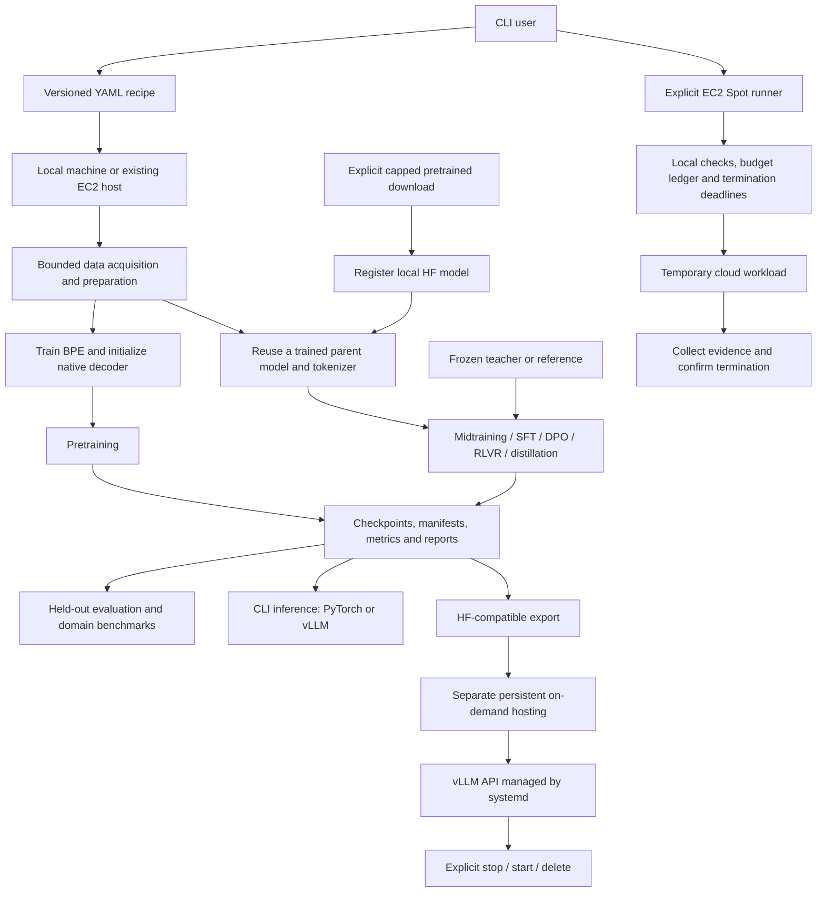
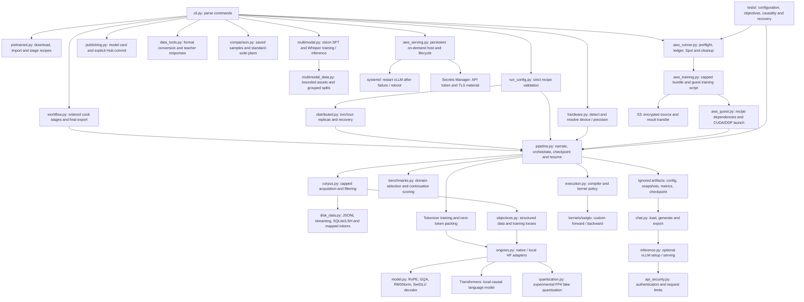

# ModelChef

**Your ingredients. Your recipe. Your model.**

With ModelChef, **pick your ingredients, choose a recipe, cook your model and serve it**. Your ingredients are text, image or speech datasets and optional pretrained weights; your recipe defines processing, architecture and training. Cook a text model from scratch or refine an existing text, vision-language or Whisper model, taste-test it with evaluation, then use CLI inference, publish to Hugging Face, or serve supported text models through a secured vLLM API. The same Python/PyTorch codebase runs locally and on AWS, with precision, kernels and execution settings exposed in versioned configuration.

Think of the workflow as **ingredients → recipe → training → evaluation → serving**. Start with one small experiment, then compose stages with `cook`: domain midtraining, instruction tuning, preference learning or distillation. ModelChef records manifests, checkpoints and lineage and explains progress as it runs. You decide what to build and how much to spend; the platform executes the declared steps.


## Quick Start

The Quick Start examples below run on your current machine. ModelChef can also launch AWS instances: see [the Spot training example](#run-a-managed-training-stage) for a temporary training job that terminates when finished, or [the API hosting example](#persistent-api-hosting-on-ec2) for persistent on-demand serving. AWS launches require configured credentials and explicit execution with `--run`, and incur charges. Start with a small local experiment; the default training run tests the pipeline rather than producing a useful assistant.

### Prepare your kitchen: set up once

With Git and [uv](https://docs.astral.sh/uv/getting-started/installation/) installed, run these commands in Linux, WSL or macOS Terminal. Windows GPU users should first follow the [WSL setup](#windows-with-an-nvidia-gpu-prepare-wsl2). The repository currently requires GitHub access.

```bash
git clone https://github.com/ashaytamhane/modelchef.git
cd modelchef
uv venv --python 3.12
source .venv/bin/activate
uv pip install -e '.[dev,pipeline]'
python -m modelchef.cli setup
python -m modelchef.cli setup --apply
python -m modelchef.cli doctor
python -m modelchef.cli smoke
```

Routine input and dependency errors give concise messages; add `--debug` to show a traceback. `check-config` validates runtime settings, training recipes or linked workflow recipes without executing them. CLI commands print immediate progress, elapsed-time updates every 10 seconds during longer operations, and a completion message to stderr. `doctor` explains its Python/PyTorch import, device discovery and GPU calculation checks as they happen. Use `--quiet` to suppress CLI progress; result output remains on stdout. Training retains its recipe-controlled detailed or brief narration.

`setup` previews the PyTorch installation; `--apply` installs it. Review the preview for your hardware. If prerequisites are missing, see [local setup](#local-setup). Package installation requires internet access.

`doctor` inspects Python/PyTorch versions, available accelerators and GPU memory. On CUDA, it also checks a small matrix multiplication. Use its output to confirm that the environment sees the device you intend to use.

`smoke` performs one training update on a tiny synthetic model, saves a temporary checkpoint, and verifies that model weights and optimizer state reload correctly. Look for `training_step: passed` and `checkpoint_recovery: passed`. Run it after `doctor` to verify that training and checkpointing work before starting a language-model experiment. Neither command downloads datasets or launches AWS resources.

### Choose your recipe

A recipe is a YAML file describing the data, preprocessing, tokenizer, model, training settings, evaluation and training stage. Start from a complete example:

```bash
cp configs/pretrain-local.yaml configs/my-run.local.yaml
```

Edit these fields **inside the existing sections** of the copied file, keeping the remaining settings:

```yaml
name: my-first-run
data:
  max_documents: 256       # Bound the corpus sample.
  max_tokens: 200000       # Bound packed data, independently of training steps.
tokenizer:
  vocab_size: 4096
model:
  layers: 6
  hidden_size: 512
  context_length: 128      # Tokens per training sequence.
training:
  accelerator: auto
  precision: auto
  steps: 40
  micro_batch_size: 1      # Reduce activation memory on a small GPU.
  gradient_accumulation: 4 # Effective batch size: 1 * 4 = 4 sequences.
evaluation:
  benchmark: auto
stage:
  kind: pretrain
```

This is an edit guide, not a replacement for the complete copied recipe. Validate with `python -m modelchef.cli pipeline configs/my-run.local.yaml`; add `--run` to execute it. Fields you omit use defaults; some become required when you select another workflow. See [required versus optional](#required-versus-optional). Unsupported fields and incompatible settings fail validation. `*.local.yaml` files stay out of Git. For fine-tuning, use `stage-config` in workflow 3 to generate a recipe matching the parent model instead of manually copying its architecture. See [published recipe patterns](#published-recipes-and-small-scale-adaptations) for starting points and the [complete annotated recipe](#complete-annotated-recipe) for every training field and its alternatives, and [data and recipes](#data-and-recipes) for local-data examples.

### Combine recipes into one cook

A training recipe controls one stage. A workflow recipe connects stages and exports the final model, so you do not have to copy run paths by hand:

```bash
python -m modelchef.cli cook configs/workflow-local.yaml
python -m modelchef.cli cook configs/workflow-local.yaml --run
```

Inspect the provided workflow and supply its local instruction dataset before executing it. The first command validates stage configurations and shows the plan; `--run` trains them in order. `cook` runs locally and can acquire data allowed by its recipes; it does not launch AWS or start an API. See [compose a complete workflow](#compose-a-complete-workflow) for the stage links and pretrained starting point.

### 1. Cook from scratch: try the included ingredients

```bash
python -m modelchef.cli check-config configs/pretrain-demo.yaml
python -m modelchef.cli pipeline configs/pretrain-demo.yaml --run
# Or pretrain, instruction-tune and export in one cook:
python -m modelchef.cli cook configs/workflow-demo.yaml --run
```

After installing dependencies, these examples work offline: they use [included, self-authored text and instruction pairs](examples/starter/README.md), a tiny two-layer CPU/FP32 model, four updates per stage and no external benchmark. They do not download datasets/models or launch AWS. The pipeline explains each step and prints the run directory; inspect `report.json` for evaluation and checkpoint-recovery results. This is a software demonstration, not a useful assistant.

For your next experiment, use the larger public-data recipe:

```bash
python -m modelchef.cli pipeline configs/pretrain-local.yaml
python -m modelchef.cli pipeline configs/pretrain-local.yaml --run
```

This acquires up to 256 FineWeb-Edu documents within a 16 MB corpus-response cap, trains BPE and an approximately 18.6M-parameter decoder for 40 steps, and evaluates a bounded benchmark sample. The first command previews; `--run` permits the configured downloads and training.

### 2. Taste the result: try your checkpoint

Replace `RUN_DIR` with the completed directory printed by workflow 1:

```bash
python -m modelchef.cli chat RUN_DIR --prompt "Education helps people" --max-tokens 24
python -m modelchef.cli chat RUN_DIR
python -m modelchef.cli export RUN_DIR
```

Interactive mode supports `/reset` and `/exit`. Export creates `RUN_DIR/export/` for compatible inference tools. Expect poor text quality from this short training test. To serve the export to clients, continue with [vLLM API serving](#serve-your-model-inference-and-api); remote access requires TLS and authentication.

### 3. Refine an existing model: fine-tune on your data

Use an existing compatible local Hugging Face model directory and a UTF-8 JSONL file containing `prompt` and `response` strings. Supply at least three distinct accepted examples (prefer more for useful split coverage), with answers short enough for the configured context. [Data preparation](#prepare-your-own-ingredients-data) covers text/CSV conversion; [pretrained acquisition](#start-from-a-pretrained-model) covers an explicit capped download if you do not already have a model.

```bash
uv pip install -e '.[pretrained]'
python -m modelchef.cli import-model LOCAL_MODEL_DIR --context 128
# Replace PARENT_RUN with the imported run directory printed above.
python -m modelchef.cli stage-config PARENT_RUN --kind sft --data data/raw/sft.jsonl --output configs/sft.local.yaml --steps 40
python -m modelchef.cli pipeline configs/sft.local.yaml
python -m modelchef.cli pipeline configs/sft.local.yaml --run
python -m modelchef.cli chat NEW_RUN_DIR
```

This keeps the pretrained tokenizer and weights and learns from your supplied responses. Import and training use local model files; they do not fetch weights implicitly. Choose a model that fits available memory; this workflow defaults to full-parameter fine-tuning; see [optional LoRA](#parameter-efficient-fine-tuning-with-lora) to train adapters instead. Later sections cover domain midtraining, preferences, verifiable rewards, distillation and AWS execution.

For images and speech, continue with the [multimodal tutorial](docs/MULTIMODAL.md). To share a completed export, follow the [Hugging Face publishing tutorial](docs/PUBLISHING.md). Both workflows use explicit recipes; publishing previews are offline and uploads require `--run`.

## The platform at a glance

The central workflow is a YAML recipe executed by `pipeline`: acquire a bounded sample, prepare and split documents, train or reuse a tokenizer, initialize or load a model, optimize it, evaluate it, and save a reproducible run. The script explains each step on screen and records the same explanations alongside the artifacts.

There are two starting points. **From scratch** learns both the tokenizer and model weights from your corpus. **From a pretrained model** retains its tokenizer and weights so you can specialize it with much less training. Both can lead to later training stages, evaluation, CLI inference and export for vLLM.

| Goal | Starting point | Next workflow |
| --- | --- | --- |
| Learn or experiment with the complete training pipeline | Bounded FineWeb-Edu sample | Local pretraining, then inspect metrics and generated text |
| Adapt a model to a domain | Existing native or imported model | Midtraining on domain documents |
| Teach instruction following or a response style | Existing model and prompt/response pairs | Supervised fine-tuning (SFT) |
| Train from preferred answers | Existing model and chosen/rejected pairs | Direct preference optimization (DPO) |
| Train with automatically checkable answers | Existing model and a verifier | Experimental reinforcement learning with verifiable rewards (RLVR) |
| Transfer behavior to a smaller model | Teacher and student | Sequence or token distillation |
| Share a trained model | Compatible local export | Authenticated vLLM API; TLS for remote access |

Start with the local pipeline test before increasing data, model size or cloud spend. A successful short run establishes that the software works; it does not produce a capable assistant or establish benchmark quality. Local CPU/CUDA paths, native LoRA objectives, CUDA QLoRA recovery/export, CPU DDP dense/MoE recovery and the example CUDA kernel have been exercised. Real-device macOS/ROCm, live managed AWS training, full standard suites and native Blackwell FP4 need separate validation.

## Choose your learning path

All three paths follow **data → model/tokenizer → training → evaluation → inference**. “Beginner” here means new to this platform, with ML fundamentals already familiar. Each level adds control over the same pipeline, rather than introducing a different tool.

| Cohort | What you will do | Result |
| --- | --- | --- |
| [Beginner](#beginner-run-and-understand-the-pipeline) | Use a bounded public sample and a provided recipe, inspect the run, recover a checkpoint and try CLI inference | A complete local experiment and an understanding of its artifacts |
| [Intermediate](#intermediate-adapt-models-to-your-data) | Prepare your own data, import or reuse a model, select a training objective, compare results and serve an API | A customized model workflow with explicit data formats and evaluation choices |
| [Advanced](#advanced-control-execution-and-deployment) | Use the full recipe, audit data assumptions, experiment with precision/kernels, run standard suites and manage cloud training/hosting | Reproducible experiments with deeper execution and lifecycle control |

Read [local setup](#local-setup) once. Follow one path or progress through all three. Use the [complete annotated recipe](#complete-annotated-recipe), [code architecture](#code-architecture), [troubleshooting](#troubleshooting) and [CLI reference](#cli-reference-and-repository-layout) as references rather than prerequisites.


## Execution and architecture
### High-level architecture



The local pipeline runs where invoked; it does not choose or provision AWS automatically. Run artifacts and downloaded models remain outside Git. Post-training objectives and pretrained import/SFT/export are covered by small CPU tests, with native stages also exercised on CUDA. Real-device macOS, live AWS training and native FP4 validation require their respective environments.

| Goal | Where execution happens | What to run | AWS required? |
| --- | --- | --- | --- |
| Pretrain on a bounded corpus sample | Current machine (local or an existing EC2 host) | `pipeline CONFIG --run` | No automatic provisioning |
| Talk to a trained checkpoint | Current machine | `chat RUN_DIR` | No |
| Export trained weights | Current machine | `export RUN_DIR` | No |
| Check your laptop/desktop GPU | Current machine | `doctor`, `resolve-runtime`, `smoke` | No |
| Develop code and run unit tests | Current machine | `python -m pytest -q`, `python -m ruff check .` | No |
| Install PyTorch or vLLM | Current machine | `setup --apply`, `setup-vllm --apply` | No |
| Serve an existing local model export | Current Linux/WSL CUDA machine | `serve-vllm ... --run` | No |
| Host an API on EC2 | Separate persistent on-demand host | `aws-serve CONFIG --run` | Yes; ongoing charges until explicitly stopped/deleted |
| Preview an EC2 test | Local controller makes read-only AWS requests | `aws-test` | Credentials, but no instance launched |
| Provision and test a cloud GPU | Local controller launches a temporary EC2 instance; tests run there | `aws-test ... --run` | Yes; incurs AWS charges |
| Launch a training stage | Local controller packages inputs; a temporary Spot host trains | `aws-train CONFIG --run` | Yes; incurs AWS charges |
| Recover cloud results/cleanup | Local controller queries AWS and removes temporary resources after termination | `aws-reconcile` | Yes; no new instance launched |

Commands run **where you invoke them**. If you SSH into an existing EC2 instance and run `doctor`, it inspects that EC2 instance. It does not provision another machine. `aws-test --run` and `aws-train CONFIG --run` explicitly launch temporary Spot compute. `aws-serve CONFIG --run` launches a separate persistent on-demand serving host.

`configs/local.yaml` and `configs/aws.yaml` describe runtime/model planning settings. Selecting `aws.yaml` does **not** deploy anything. `configs/aws-test.yaml` is the separate EC2 provisioning/budget configuration.

## Local setup

### Windows with an NVIDIA GPU: prepare WSL2

Use the Windows NVIDIA driver. Do not install a Linux NVIDIA display driver inside WSL. See the [NVIDIA WSL guide](https://docs.nvidia.com/cuda/wsl-user-guide/index.html).

In Windows PowerShell:

```powershell
nvidia-smi
wsl --status
wsl --list --verbose
# Only if Ubuntu is not already installed; installation may require administrator rights.
wsl --install -d Ubuntu-24.04
```

Restart if requested, open Ubuntu, and create your normal Linux user. Verify Ubuntu internet access before installing packages:

```bash
curl --connect-timeout 10 --max-time 15 -I https://pypi.org
nvidia-smi
```

Docker is optional; it is not required for the CLI or Spot runner.

### Linux/WSL: clone and create the development environment

Install Git, a C compiler and curl using your distribution's package manager. On Ubuntu:

```bash
sudo apt update
sudo apt install -y git curl build-essential
curl -LsSf https://astral.sh/uv/install.sh | sh
export PATH="$HOME/.local/bin:$PATH"
mkdir -p ~/projects
cd ~/projects
git clone https://github.com/ashaytamhane/modelchef.git
cd modelchef
uv venv --python 3.12
source .venv/bin/activate
uv pip install -e '.[dev,pipeline]'
python -m modelchef.cli --help
python -m pytest -q
python -m ruff check .
```

The repository is private, so GitHub authentication is needed to clone it. Keep WSL working files on the Linux filesystem rather than under `/mnt/c` for development performance. Installation downloads software packages, not training corpora or pretrained models. See [uv installation](https://docs.astral.sh/uv/getting-started/installation/) for other platforms.

### Windows-only controller or CPU development

A Windows controller does not need PyTorch or a GPU to launch AWS tests. With Python 3.12 and Git installed:

```powershell
git clone https://github.com/ashaytamhane/modelchef.git
cd modelchef
py -3.12 -m venv .venv-aws
.\.venv-aws\Scripts\Activate.ps1
python -m pip install -e '.[dev,aws]'
python -m modelchef.cli --help
python -m pytest -q
```

If PowerShell activation is unavailable, invoke `.\.venv-aws\Scripts\python.exe` directly instead of `python`. Local GPU inference through the automatic vLLM setup requires Linux/WSL NVIDIA CUDA.

### macOS: Apple Silicon or Intel MacBook

macOS runs the same Python codebase directly; WSL and CUDA are not required. The hardware detector selects PyTorch's MPS backend when available, otherwise CPU. Automatic precision selection uses FP32 on both. macOS setup paths exist, but a complete run has **not yet been validated on a real MacBook**.

On Apple Silicon, install Git and `uv` using your preferred method, then run these commands in Terminal. The repository requires GitHub authentication:

```bash
git clone https://github.com/ashaytamhane/modelchef.git
cd modelchef
uv venv --python 3.12
source .venv/bin/activate
uv pip install -e '.[dev,pipeline]'
# Preview the macOS PyTorch installation before applying it.
python -m modelchef.cli setup
python -m modelchef.cli setup --apply
python -m modelchef.cli doctor
python -m modelchef.cli smoke --precision fp32
python -m pytest -q
```

Check `doctor` for `backend: mps` and `mps_available: true` to confirm GPU availability. An Apple Silicon Mac can use MPS when its OS and PyTorch build support it; The automatic installer targets Apple Silicon. Official modern PyTorch wheels are unavailable for Intel macOS; an Intel Mac can use an existing compatible source/community build for CPU training, or serve as a lightweight AWS controller. ModelChef does not reject an otherwise compatible existing Intel environment. See the [upstream Intel macOS announcement](https://dev-discuss.pytorch.org/t/pytorch-macos-x86-builds-deprecation-starting-january-2024/1690). If an operation fails on MPS, verify the CPU path explicitly:

```bash
python -m modelchef.cli smoke --accelerator cpu --precision fp32
```

To preview and then execute a bounded pretraining run on the Mac itself:

```bash
python -m modelchef.cli pipeline configs/pretrain-local.yaml
# This downloads the configured small corpus/benchmark samples and trains locally.
python -m modelchef.cli pipeline configs/pretrain-local.yaml --run
```

The recipe's `training.accelerator: auto` selects the available backend. To force CPU training, copy the recipe and set `training.accelerator: cpu` and `training.precision: fp32`. Reduce model dimensions, context length or microbatch size if memory is insufficient; hardware detection does not automatically resize the model.

After training, replace `PATH_TO_COMPLETED_RUN` with the run directory printed by the pipeline:

```bash
python -m modelchef.cli chat PATH_TO_COMPLETED_RUN --backend torch
```

The CLI supports `/reset` and `/exit`. A short training test produces limited text quality; SFT support does not make a tiny validation model a useful assistant. Use the PyTorch backend on macOS: the project's automatic vLLM installation targets Linux/WSL with NVIDIA CUDA. A Mac can also act as an AWS controller after installing `.[aws]` and following the AWS section.

### Hardware support and validation

| Environment | Training / PyTorch CLI inference | Automatic precision | Validation status |
| --- | --- | --- | --- |
| NVIDIA CUDA on Linux/WSL | CUDA | BF16 when reported supported; otherwise FP32 | Local CUDA pretraining and checkpoint/inference checks exercised |
| macOS with available MPS | Apple GPU through MPS | FP32 | Detection/setup implemented; real MacBook validation pending |
| CPU, including Intel Macs | CPU | FP32 | Small CPU pipeline and checkpoint tests exercised; not validated on macOS hardware |
| Compatible AMD GPU on Linux | ROCm | BF16 when reported supported; otherwise FP32 | Detection/setup implemented; real-device validation pending |

The automatic vLLM installer supports Linux/WSL NVIDIA CUDA only. Backend detection establishes availability, not compatibility of every operation or a guarantee that the configured model fits in memory.

### Install PyTorch and verify the runtime

Creating the base environment does not install PyTorch. First preview the installation:

```bash
python -m modelchef.cli setup
# Or deliberately choose a CPU-only environment:
python -m modelchef.cli setup --backend cpu
```

Review the detected backend, driver and proposed command. Install into the active environment only when ready:

```bash
python -m modelchef.cli setup --apply
python -m modelchef.cli doctor
python -m modelchef.cli check-config configs/local.yaml
python -m modelchef.cli resolve-runtime configs/local.yaml --output artifacts/environment/resolved-local.json
python -m modelchef.cli smoke
```

Expected results: `doctor` describes the available backend; on CUDA it also checks matrix multiplication. `smoke` reports `training_step: passed` and `checkpoint_recovery: passed`. These are synthetic checks, not language-model training or throughput measurements.

The default stack pins PyTorch 2.13.0 and NumPy 2.3.5. The default CUDA 13.0 installation plan requires NVIDIA driver major version 580 or newer. Setup installs packages, not drivers or OS prerequisites. For another GPU/driver combination, select an appropriate official build with `--torch-version` and `--index-url`; check the [PyTorch installation selector](https://pytorch.org/get-started/locally/). ROCm setup needs an explicit compatible wheel index; MPS requires macOS. Those backends still need real-device validation.

### Precision and memory basics

| Setting | Behavior |
| --- | --- |
| `accelerator: auto` | Available CUDA/ROCm, then MPS, otherwise CPU |
| `precision: auto` | BF16 when PyTorch reports support on CUDA/ROCm; otherwise FP32 |
| `fp16` | Explicit CUDA/ROCm training with gradient scaling |
| `fp32` | Default fallback; useful for CPU checks |
| Native NVFP4 training | `model.quantization: nvfp4`; native dense Blackwell/Transformer Engine integration |
| QLoRA | Imported-model CUDA NF4 base with trainable adapters |
| FP4 simulation | `model.quantization: fp4_fake`; experimental software fake quantization with FP32/BF16 master weights |
| Native NVFP4 inference | `inference.quantization: nvfp4_per_token`; supported Blackwell CUDA hardware and vLLM required |

FP16 and BF16 reduce the size of many activation tensors compared with FP32. BF16 retains a wider exponent range; FP16 training uses gradient scaling to reduce underflow risk. Mixed precision does not make all parameters or optimizer state low precision.

BF16 reporting can include emulated support; it does not establish native acceleration or performance. Explicit unavailable backends/precision fail rather than silently switching. The pretraining recipe uses microbatches of 2; runtime planning defaults to 1 when unspecified; automatic model-specific memory calibration is pending.

Examples:

```bash
# Debug checkpoint behavior without using the GPU.
python -m modelchef.cli smoke --accelerator cpu --precision fp32
# Check mixed-precision training on your current CUDA machine.
python -m modelchef.cli smoke --accelerator cuda --precision fp16
```

## Beginner: run and understand the pipeline

**Start with the ingredients:** complete one bounded experiment on your own machine. Start with the provided native model and public corpus recipe; no pretrained weights or AWS resources are required.

### Pick the ingredients: understand your data

`configs/pretrain-local.yaml` selects an ordered FineWeb-Edu sample through the public dataset viewer. The document, response-byte and token caps keep the experiment small; this is not representative random sampling or a full corpus download. Quality filters, regex PII handling and lexical deduplication run before seeded document splits. Benchmark sample text is also excluded by word n-gram overlap checks.

Keep the defaults for your first run. Previewing the recipe does not fetch data; `--run` does. To work offline, follow the intermediate local-document example after installing dependencies.


### Cook your first model: run training

Complete [local setup](#local-setup) and PyTorch installation, then install pipeline dependencies in the same environment:

```bash
uv pip install -e '.[dev,pipeline]'
python -m modelchef.cli doctor
# Validate every recipe section; this command performs no download or training.
python -m modelchef.cli pipeline configs/pretrain-local.yaml
# Download the bounded samples and execute on the current machine.
python -m modelchef.cli pipeline configs/pretrain-local.yaml --run
```

The default recipe requests at most 256 FineWeb-Edu documents, caps corpus responses at 16 MB and benchmark downloads at 2 MB, and caps packed data at 200,000 tokens. It creates an approximately 18.6M-parameter decoder and runs 40 optimizer steps. This is a pipeline test, not enough training for useful conversation. Dataset access uses the public Hugging Face viewer; no pretrained model weights are downloaded.

The pipeline explains each stage on screen: configuration/hardware, acquisition, benchmark selection, cleaning and document splits, BPE training, token packing, model construction, optimization, held-out evaluation and generation. `explain: brief` reduces console detail; the event log remains saved.

Each invocation creates its own directory under `artifacts/training/`. Inspect `report.json`, `processing.json`, source/benchmark manifests, `metrics.jsonl`, `environment.json`, tokenizer and checkpoints there. Data snapshots are cached under `data/cache/`. All run outputs and data caches stay excluded from Git.

#### What this run is doing

Byte-level **BPE** learns frequently occurring byte sequences as tokens, so the vocabulary can represent arbitrary text while compressing common patterns. It is fitted only on training documents. **Packing** joins tokenized documents into fixed-length sequences separated by EOS; this implementation allows attention across document boundaries within a packed sequence.

The native model is a decoder-only transformer: causal attention predicts each next token from preceding tokens. **RoPE** encodes relative position by rotating query/key components; **GQA** shares key/value heads across groups of query heads; **RMSNorm** normalizes activations; and **SwiGLU** gates the feed-forward activation. These are architectural choices exposed by the recipe, rather than independent training stages.

The run separates training, validation and test documents before fitting the tokenizer. Validation tracks optimization; test loss is a held-out check. Neither a loss decrease nor a generated sample establishes usefulness on an application task.

### Checkpoints and reproducibility

Use the original configuration and a saved checkpoint path:

```bash
python -m modelchef.cli pipeline configs/pretrain-local.yaml --run --resume PATH_TO_CHECKPOINT
```

Resume restores model, optimizer, scaler, sampler and random states and checks configuration/data/tokenizer fingerprints. The configuration must match exactly, and the original data snapshot must remain available. It continues toward the original step target; changing the target or dataset is a new experiment, not checkpoint recovery. CPU tests verify uninterrupted versus resumed weights agree; exact behavior across different hardware/software is not guaranteed.

### Taste-test the model: read evaluation results

Open the printed run directory and inspect `report.json`: compare `initial_validation` with final `validation`, inspect `test`, and check `checkpoint_recovery`. `processing.json` explains which documents were rejected, while source and benchmark manifests identify the exact saved inputs. `metrics.jsonl` records loss, learning rate, gradient norm and estimated throughput over optimizer steps.

Validation and test loss measure next-token prediction on this sample/tokenizer. The small task benchmark checks evaluation wiring; it is not a reliable application-quality estimate. Decide whether data preparation and optimization behaved as intended before increasing scale.


### Serve the result: interact or export

Replace `PATH_TO_COMPLETED_RUN` with the directory printed after successful training:

```bash
python -m modelchef.cli chat PATH_TO_COMPLETED_RUN --backend torch
python -m modelchef.cli chat PATH_TO_COMPLETED_RUN --prompt "Education helps people" --max-tokens 24
python -m modelchef.cli export PATH_TO_COMPLETED_RUN
```

Interactive mode supports `/reset` and `/exit`. This is a CLI completion/chat loop with bounded history, not a tool agent. A pretrained base model has not learned instruction following; the tiny test model will mostly produce incoherent text.

Export writes compatible Llama configuration, tokenizer and safetensors weights into the run's `export/` directory. On supported Linux/WSL CUDA hardware, install the optional inference stack using the [intermediate vLLM setup](#install-and-serve-with-vllm), then run:

```bash
python -m modelchef.cli chat PATH_TO_COMPLETED_RUN --backend vllm --max-tokens 24
```

The vLLM chat backend exports the trained weights if necessary and loads them locally. For a separate server, copy `configs/inference.yaml` to ignored `configs/inference.local.yaml`, point it at that export and use `serve-vllm`. On macOS or CPU, use the PyTorch chat backend.

**Before moving on:** you should have a completed run, understand its data limits and reports, and be able to load its checkpoint. A tiny run may still generate incoherent text. Continue to the intermediate path to change data or train instruction behavior.


## Intermediate: adapt models to your data

**Refine the recipe:** choose data and an objective for a concrete model behavior, then evaluate and serve the result. You can reuse the beginner checkpoint or start from a compatible pretrained model. These are alternative starting points; you do not need to pretrain a new model before fine-tuning an imported one.


### Data and recipes

### Understand and customize the recipe

Copy a provided YAML recipe to an ignored `configs/*.local.yaml` file before editing it. `configs/local.yaml` and `configs/aws.yaml` are runtime-planning configs; `configs/pretrain-*.yaml` and `configs/posttrain-*.yaml` are complete training recipes. `check-config CONFIG` validates runtime configs, training recipes and workflow recipes; `pipeline CONFIG` previews a training recipe. The strict schema rejects unsupported fields and incompatible settings; `configs/pretrain.schema.json` describes the full structure. Run `pipeline YOUR_CONFIG` to validate before executing.

Change one family of settings at a time. Document and byte caps control acquisition; the token cap controls packed data; optimizer steps control how often that data is sampled for updates. They are independent limits, so increasing steps can repeatedly train on the same small sample. For a single-device run, effective batch size is `micro_batch_size * gradient_accumulation`. Gradient checkpointing trades extra computation for lower activation memory; it does not reduce model or optimizer-state storage.

| Section | Controls |
| --- | --- |
| Run settings | Name, output directory, detailed/brief explanations |
| `data` | Source, subset, split, offset, document/byte/token caps, domain and keyword filter |
| `processing` | Unicode/HTML handling, quality limits, exact/near deduplication, PII policy, benchmark n-grams and document split fractions |
| `tokenizer` | Byte-level BPE vocabulary, minimum frequency, special tokens, BOS/EOS insertion |
| `model` | Layers, width, attention/KV heads, intermediate width, context, RoPE, RMSNorm, dropout, tied embeddings and gradient checkpointing |
| `training` | Device, precision, seed, determinism, optimizer steps, microbatch, accumulation, AdamW, schedule, clipping, checkpoints and runtime cap |
| `stage` | Training objective, parent/teacher runs, reasoning format, preference and reward settings |
| `evaluation` | Benchmark selection/sample/download cap, loss batches and generation controls |

From-scratch experiments use the native causal RoPE decoder with GQA, RMSNorm and SwiGLU, plus a trained byte-level BPE tokenizer. Imported Hugging Face models use their original architecture and tokenizer through the local pretrained adapter. Optional reasoning supervision, execution kernels and stage objectives are configured in the same recipe. The runtime limit is checked between training steps, not a deadline for the entire acquisition/evaluation workflow. Hardware detection does not automatically choose a model size that fits memory.

### Prepare your own ingredients: data

For larger local corpora, copy a complete pretraining recipe and change its `data`
section as follows (these are overrides, not a standalone recipe):

```yaml
data:
  provider: local_jsonl
  local_path: null
  local_paths: [data/train-000.jsonl, data/train-001.jsonl]
  storage: disk
  max_documents: 100000
  max_download_bytes: 1000000000
  max_record_bytes: 4000000
  max_tokens: 10000000
```

Shard order and offset define the selected snapshot. Disk mode streams records through
SQLite deduplication, writes deterministic disjoint splits and stores uint32 tokens in
memory-mapped files. Training allocates only selected token batches; resume verifies the
mapped files before using them. It supports local JSONL pretraining/midtraining and DDP.
Use `storage: memory` for structured post-training objectives. Near deduplication uses
approximate LSH candidate search; tokenizer learning and benchmark indexes still use RAM.
Set byte/token/runtime limits deliberately and allow disk space for snapshots and indexes.
Managed AWS training carries these settings into the guest, with the additional bundle cap.
See [quality and acceptance criteria](docs/QUALITY.md) for scale and hardware validation boundaries.


```bash
python -m modelchef.cli convert-data documents.txt --format text --output data/raw/documents.jsonl --max-bytes 10000000 --max-documents 1000
python -m modelchef.cli convert-data instructions.csv --format csv --output data/raw/sft.jsonl
```

Text conversion treats blank-line-separated paragraphs as documents. CSV headers become JSON field names: use `text` for midtraining or `prompt,response` for SFT. JSONL conversion also exists. Conversion preserves records; training performs objective-specific validation and filtering. PDFs, images, audio and arbitrary schemas require a separate extraction/mapping step. Outputs refuse to overwrite existing files. Choose source licenses and training rights appropriate to your intended use.

### Finance-focused experiment

```bash
python -m modelchef.cli pipeline configs/pretrain-finance.yaml
python -m modelchef.cli pipeline configs/pretrain-finance.yaml --run
```

This recipe searches a bounded FineWeb-Edu slice using explicit finance keywords. It is a domain-filtering experiment, not a curated financial corpus. Filtering can leave too few documents; increase the approved sample limit or supply appropriate local data if that occurs.

Automatic evaluation maps `general` to a small HellaSwag sample and `finance` to FinancialPhraseBank sentiment examples. Other domains require an explicit benchmark override or `benchmark: none`. Respect source licenses: [FineWeb-Edu](https://huggingface.co/datasets/HuggingFaceFW/fineweb-edu), [HellaSwag](https://huggingface.co/datasets/Rowan/hellaswag), and [FinancialPhraseBank](https://huggingface.co/datasets/takala/financial_phrasebank), whose license includes noncommercial and share-alike restrictions.

Scores use this project's custom zero-shot continuation-scoring protocol, not official lm-evaluation-harness scores. A handful of examples tests evaluation wiring; it cannot establish model quality. Only the evaluated sample is automatically included in benchmark decontamination.

### Train on your own local documents

Place JSONL data under ignored `data/raw/`, with one object per line containing a `text` field. Copy the local recipe and change:

```yaml
data:
  provider: local_jsonl
  local_path: data/raw/documents.jsonl
  text_field: text
  domain: general
  max_documents: 256
  max_download_bytes: 16000000
  max_tokens: 200000
evaluation:
  benchmark: none
```

Edit these sections in the copied complete recipe; keep the other settings. `benchmark: none` avoids benchmark network access. Install dependencies beforehand for an offline run. Supply enough distinct documents for filtering and all three splits, and enough tokens to form context blocks. Tokenizer merges are learned only from the training split.

Regex PII removal and lexical deduplication are limited heuristics. Preserve the cached raw snapshot and its SHA256 for replay: the viewer API is mutable, and the manifest does not pin an upstream Git revision. Initial slices are bounded samples, not representative random samples of the full corpus.

### Start from a pretrained model

Install the optional adapter dependencies alongside your PyTorch environment:

```bash
uv pip install -e '.[pipeline,pretrained]'
# Metadata-only preview: pins the resolved upstream revision and checks total file size.
python -m modelchef.cli download-model HuggingFaceTB/SmolLM2-135M --max-bytes 500000000
# Explicitly execute only after reviewing model license, size and disk/memory requirements.
python -m modelchef.cli download-model HuggingFaceTB/SmolLM2-135M --max-bytes 500000000 --run
python -m modelchef.cli import-model PATH_TO_DOWNLOADED_MODEL --context 128
```

Import registers local model weights and tokenizer as a parent run; it does not train them. Use the printed imported run directory as `PATH_TO_PARENT` in the next section. `midtrain` uses your raw text; `sft` uses your instruction/response data; DPO/RLVR use their corresponding formats. This reuses the pretrained tokenizer and weights, rather than starting from random initialization. Models supported by Transformers' causal-language-model auto classes with fast tokenizers can use the adapter; remote model code and implicit model downloads are disabled. Compatibility and memory use still depend on the selected architecture. A local tiny GPT-2 fixture tests import, SFT and export; this is not a claim that every Hub model has been validated.

The downloader selects safetensors weights and tokenizer/configuration assets, records resolved revision and file hashes, and excludes Python code and pickle weight files. Downloads stay under ignored `artifacts/pretrained/`. An existing local HF export can be imported directly without network access. Imported models keep a dependency on that local source directory; retain it for future stages and exports.

Hugging Face supplies dataset/model distribution, tokenizer tooling and a compatibility format. The native model and training loop are project code; starting from scratch does not load pretrained weights. Imported models use the optional Transformers adapter.

### Refine your model: continue training

Midtraining keeps the next-token objective but changes the corpus, for example to domain documents. SFT instead learns supplied responses while masking prompt tokens from the loss. DPO increases the relative likelihood of a chosen response compared with a rejected response, using a frozen reference to anchor the change. RLVR samples answers and obtains a reward from a deterministic verifier; it needs the model to produce enough varied, sometimes-correct answers for a useful learning signal.

These are separate experiment choices, not a mandatory sequence. Full-parameter fine-tuning is the default. Native and imported models support optional LoRA across continuation stages; imported models additionally support CUDA NF4 QLoRA. Choose the objective and adaptation method independently within the supported combinations.

Use a completed or imported run as the parent. `stage-config` copies its architecture and tokenizer settings, avoiding manual mismatches. Write personal recipes to ignored `configs/*.local.yaml` files:

```bash
python -m modelchef.cli stage-config PATH_TO_PARENT --kind sft --data data/raw/sft.jsonl --output configs/sft.local.yaml --steps 40
python -m modelchef.cli pipeline configs/sft.local.yaml
python -m modelchef.cli pipeline configs/sft.local.yaml --run
python -m modelchef.cli chat PATH_TO_NEW_COMPLETED_RUN
```

Each stage creates a new run and optimizer; it retains the parent's weights and vocabulary. `--resume` recovers a stage using that stage's own saved optimizer and random states. Parent and teacher checkpoint hashes are recorded and checked during recovery. Parent artifacts must remain available.

| Stage / `--kind` | JSONL record fields | Objective |
| --- | --- | --- |
| `midtrain` | `text` | Continued next-token cross entropy on specialized documents |
| `sft` | `prompt`, `response` | Response-only cross entropy; prompt/padding loss masked |
| `dpo` | `prompt`, `chosen`, `rejected` | Preference objective against a frozen parent reference |
| `rlvr` | `prompt`, `answer` | Sampled group-relative policy objective and reference KL with exact-match or integer rewards |
| `distill` | `prompt`, `response` | Teacher-distribution KL mixed with response cross entropy |

Examples, one per JSONL line:

```json
{"prompt":"What does a bank do?","response":"A bank accepts deposits and provides financial services."}
{"prompt":"What is 2 plus 3?","chosen":"5","rejected":"6"}
{"prompt":"What is 2 plus 3?","answer":"5"}
```

Keep separate files for each format. At least three distinct accepted records are required to form document splits. Structured stages use `User: ...` / `Assistant:` formatting. They reject overlong examples rather than silently truncate answers. Duplicate prompts are removed before splitting. Existing PII/quality/decontamination heuristics still apply; provide benchmark files for your evaluation data.

Copy `configs/posttrain-*.yaml` for full native defaults, or prefer `stage-config` for the actual parent. Edit `stage.dpo_beta`, reward/verifier, group size, rollout cap, KL coefficient and optimizer settings deliberately. RLVR is a small GRPO-inspired implementation with one update per sampled group, not a distributed production RL system. Equal rewards give zero policy advantage; mostly wrong samples may provide no useful learning signal. The integer verifier accepts a complete signed integer response, not arbitrary reasoning text or executable code. The DPO and group-relative objectives follow the ideas in [DPO](https://arxiv.org/abs/2305.18290) and [DeepSeekMath](https://arxiv.org/abs/2402.03300).

#### Parameter-efficient fine-tuning with LoRA

LoRA freezes the pretrained weights and trains small low-rank updates in selected layers. This reduces trainable parameters and optimizer memory while preserving the base model. See the original [LoRA paper](https://arxiv.org/abs/2106.09685) and [Hugging Face PEFT documentation](https://huggingface.co/docs/peft/en/package_reference/lora).

Install `uv pip install -e '.[pipeline,pretrained,peft]'`. Generate a continuation-stage recipe with `stage-config` as above, then add this block inside its existing `model:` section:

```yaml
  peft:
    method: lora
    rank: 8
    alpha: 16
    dropout: 0.0
    target_modules: [q_proj, v_proj]
    use_rslora: false
```

Target names depend on the architecture: the native decoder and Llama-style models use `q_proj`/`v_proj`; GPT-2 uses `c_attn`. Validate and run using the same `pipeline` commands. The report includes total and trainable parameter counts. PyTorch CLI chat restores the adapter automatically. `export RUN_DIR` writes separate adapter files under `RUN_DIR/adapter/` and a merged dense model under `RUN_DIR/export/` for vLLM.

Checkpoints retain the full base and adapter state for reproducible resume, so they are not adapter-sized. Keep the original local model directory. Continuing an adapter requires the same adapter settings; changing rank or targets requires exporting, importing the merged model, and starting a new adapter. LoRA supports native and imported models for midtraining, SFT, DPO, RLVR and distillation. It requires an existing parent rather than adapter-only pretraining from random weights. Native adapters use the built-in implementation; imported adapters use PEFT.

#### QLoRA: adapters on a 4-bit base

QLoRA keeps the base in NF4 storage and trains LoRA adapters, reducing base-weight memory as well as optimizer memory. NF4 is a quantization format; it is different from native NVFP4 training arithmetic. See the [QLoRA paper](https://arxiv.org/abs/2305.14314) and [PEFT quantization guide](https://huggingface.co/docs/peft/en/developer_guides/quantization).

Install `uv pip install -e '.[pipeline,pretrained,qlora]'` on a compatible NVIDIA CUDA environment. In a parent-derived Hugging Face continuation recipe, set:

```yaml
model:
  peft:
    method: qlora
    rank: 8
    alpha: 16
    target_modules: [q_proj, v_proj]
    compute_dtype: bf16     # OPTIONAL: bf16 | fp16; choose supported compute precision.
    double_quant: true     # OPTIONAL: quantize the quantization scales too.
```

This fragment edits the existing recipe, not its complete replacement. QLoRA supports the same continuation objectives as LoRA. The original model and quantization metadata remain necessary for recovery. Export merges adapters into a dense HF model for vLLM; allow memory for that full-precision export. The CUDA path has been exercised with a tiny local GPT-2 fixture, including training, export and resume. It does not imply every pretrained architecture or bitsandbytes build is compatible. QLoRA is currently single-device and cannot be combined with projection FP4 simulation or native NVFP4.

#### Optional reasoning supervision

Reasoning supervision defaults to `stage.reasoning_format: plain`. For SFT or distillation, select `think_answer` and supply JSONL records with `prompt`, `reasoning` and `answer` fields. The prepared response contains `<think>…</think>` followed by `<answer>…</answer>`. Allocate enough context for both sections. This trains the supplied explanation format; it does not establish reasoning quality. With verifiable-reward training, the optional format checks the final answer inside a single answer tag.

For example, an SFT record can be `{"prompt":"What is 2 plus 3?","reasoning":"Add three to two.","answer":"5"}`. Derive a recipe with `stage-config PATH_TO_PARENT --kind sft --reasoning think_answer --data data/raw/reasoning.jsonl --output configs/reasoning.local.yaml`. This is optional supervision of an explanation and final-answer format, not a different transformer architecture or a guarantee that the explanation is faithful.


#### Distillation

Two methods are available:

1. **Sequence distillation:** generate responses from a local teacher, then SFT the student on those responses. Teacher and student may have different tokenizers.
2. **Token distillation:** optimize student logits against a frozen teacher, with temperature-scaled KL and configurable hard-label mixing. This requires identical tokenizer contents and special-token identities; architectures may differ, and the teacher context must cover the student context.

For sequence distillation, create a JSONL file with `prompt` strings:

```bash
python -m modelchef.cli teacher-data PATH_TO_TEACHER --prompts data/raw/prompts.jsonl --output data/raw/teacher-sft.jsonl --max-documents 32 --max-tokens 32
python -m modelchef.cli stage-config PATH_TO_STUDENT --kind sft --data data/raw/teacher-sft.jsonl --output configs/sequence-distill.local.yaml
python -m modelchef.cli pipeline configs/sequence-distill.local.yaml --run
```

For a new smaller native student, run `python -m modelchef.cli init-student PATH_TO_TEACHER` first. It creates random weights and copies the teacher vocabulary; use the printed directory as `PATH_TO_STUDENT`. `--architecture FILE` accepts an architecture YAML mapping. A large teacher vocabulary can still dominate student parameter count.

For token distillation:

```bash
python -m modelchef.cli stage-config PATH_TO_STUDENT --kind distill --teacher PATH_TO_TEACHER --data data/raw/sft.jsonl --output configs/distill.local.yaml
python -m modelchef.cli pipeline configs/distill.local.yaml --run
```

Configure `stage.distillation_temperature` and `stage.distillation_alpha` in the recipe. Alpha weights the soft teacher loss; the remaining weight applies to response cross entropy. A weak teacher can teach poor behavior; a short execution test does not establish distillation benefit.

KL divergence measures the mismatch between the student's and teacher's token distributions. A higher temperature softens those distributions so alternatives to the most likely token carry more signal; the implementation scales the soft loss by temperature squared. This requires the same token IDs to mean the same things, which is why token distillation enforces identical tokenizers. Sequence distillation transfers generated text instead and avoids that constraint.

### Compose a complete workflow

`cook` joins independently reviewable stage recipes. Paths are relative to the project root. A stage normally inherits the preceding model geometry and tokenizer, while explicit adapter and execution choices can override inherited settings. Here is the composition shape; use the checked-in example for execution:

```yaml
schema_version: 1               # OPTIONAL: only version 1.
name: my-model                  # OPTIONAL: artifact prefix.
output_dir: artifacts/workflows # OPTIONAL: workflow reports.
imported_model: null            # OPTIONAL: local HF directory instead of a scratch start.
imported_context: 128           # OPTIONAL: context for an imported starting model.
export: true                    # OPTIONAL: export the final completed stage.
stages:                         # REQUIRED: at least one ordered stage.
  - name: base                  # REQUIRED: unique stage name.
    recipe: configs/pretrain-local.yaml # REQUIRED: training recipe path.
  - name: instructions
    recipe: configs/sft-recipe.yaml
    parent_stage: base          # OPTIONAL: earlier stage; otherwise previous output.
    teacher_stage: null         # CONDITIONAL: earlier teacher stage for distillation.
    inherit_architecture: true  # OPTIONAL: preserve parent geometry/tokenizer.
```

The workflow persists its plan and a report linking each stage to its run. Failed execution records the error and preserves completed artifacts. Recover an individual stage with its checkpoint using `pipeline --resume`; `cook` does not yet resume the entire workflow automatically. Run DDP stages separately with `torchrun`. Training, export and API launch remain explicit operations: use [AWS training](#run-a-managed-training-stage) or [API serving](#serve-your-model-inference-and-api) when those are your chosen execution environments.

### Taste-test and compare: evaluation

Perplexity is the exponentiated mean next-token loss: lower is better on the same held-out data and tokenization, but it is not a fair cross-tokenizer quality ranking. Task benchmarks check specific behavior; use the same dataset/protocol and report sample size, context and truncation. DPO stages additionally report preference accuracy, while RLVR reports verifier-based accuracy.

After downloading/importing any approved baseline models separately:

```bash
python -m modelchef.cli compare PATH_TO_COMPLETED_RUN --baseline PATH_TO_LOCAL_GPT2 --baseline PATH_TO_LOCAL_PYTHIA --baseline PATH_TO_LOCAL_SMOLLM2 --output artifacts/comparison.json
```

This uses the run's saved benchmark examples for every candidate, retaining each model's own tokenizer. Baselines can be completed ModelChef runs or local HF exports. Custom continuation scoring differs from published-suite protocols; tokenizers and context/truncation choices affect comparisons. No baseline weights are fetched by `compare`.

### Serve your model: inference and API

Use the candidate run you evaluated above. Start with the PyTorch CLI to check model behavior, then export it for vLLM. The inference engine changes execution and serving; it does not improve learned model behavior by itself.

#### Install and serve with vLLM

Use the Linux/WSL `.venv` from local setup, a compatible NVIDIA GPU/driver, and a C compiler:

```bash
python -m modelchef.cli setup-vllm
python -m modelchef.cli setup-vllm --apply
python scripts/vllm_smoke.py
```

The installer targets `.venv` in the project root and pins vLLM 0.31.0 with the shared PyTorch/CUDA stack. The smoke script generates from tiny random local weights; it does not test a useful trained language model. Other inference backends need their own [vLLM installation recipe](https://docs.vllm.ai/en/latest/getting_started/installation/gpu/).

vLLM is an inference engine that manages generation and batching; it does not replace the PyTorch training loop. This setup reuses the project environment.

Set `MODELCHEF_API_KEY` to a random token of at least 32 non-whitespace characters before starting even a loopback server; it is required at launch.

To serve an existing compatible Hugging Face export, set `inference.model_path` in `configs/inference.yaml` to a local directory containing `config.json`, `tokenizer.json` and safetensors or `pytorch_model.bin` weights:

```bash
python -m modelchef.cli serve-vllm configs/inference.yaml
python -m modelchef.cli serve-vllm configs/inference.yaml --run
```

The first command validates files and prints a plan. The second starts foreground serving at `http://127.0.0.1:8000/v1`. Stop it with Ctrl+C. Downloads and remote model code are disabled. A `.pt` checkpoint alone is insufficient; use `export RUN_DIR` to create the compatible model directory. Default memory utilization is 50%, context 2048 and scheduler sequence limit 4; the API boundary separately allows 2 concurrent requests. Set `max_model_len` no higher than your trained context (128 for the local test recipe); adjust for your model, and avoid simultaneous training/serving on a small GPU.

#### Share the API with other clients

Serving runs on the machine where you invoke it: a prepared Linux/WSL CUDA laptop, an existing EC2 host, or another compatible vLLM host. It does not provision a machine. Keep the process running while clients use it; AWS running costs continue for the lifetime of the host.

1. Export a completed run: `python -m modelchef.cli export RUN_DIR`. Use the printed export directory as `inference.model_path`, and set `max_model_len` to the trained context or less. Install the optional vLLM environment using the [vLLM setup instructions](#install-and-serve-with-vllm).
2. Obtain a trusted TLS certificate for the hostname clients will use. Keep its full certificate chain and private key outside Git, restrict the private key's file permissions, and put their paths in a copy of `configs/inference-public.yaml`, named `configs/inference-public.local.yaml`. Do not disable certificate verification on clients.
3. Set `MODELCHEF_API_KEY` in the serving process environment to a cryptographically random token of at least 32 characters. For example, generate a token with `python -c 'import secrets; print(secrets.token_urlsafe(48))'` and load it through your secret manager or a private environment file. Do not put the token in YAML, shell command arguments, Git or shared logs. All clients holding this token share access; rotate it by changing the environment and restarting the server.
4. Preview: `python -m modelchef.cli serve-vllm configs/inference-public.local.yaml`. Then start: `python -m modelchef.cli serve-vllm configs/inference-public.local.yaml --run`. The default local config binds loopback; the public example binds port 8443 with TLS. A missing token or missing TLS files prevents startup. Plans contain the secret's variable name, never its value.
5. Allow inbound TCP 8443 only from intended client networks in your host firewall and, on EC2, its security group. For a laptop, WSL/Windows forwarding and your router or VPN must make that port reachable. The code does not open firewall rules or router ports. Prefer a private VPN for a small group.
6. Clients send `Authorization: Bearer <token>` to `https://YOUR_HOSTNAME:8443/v1/models` or POST text requests to `/v1/completions` and `/v1/chat/completions`. For example, a completions body is `{"model":"artifacts/exports/modelchef","prompt":"Explain gravity","max_tokens":64}`; use the model ID returned by `/v1/models`. Chat requires a suitable model chat template and instruction training; a base checkpoint can use completions.

The middleware in `src/modelchef/api_security.py` authenticates every exposed HTTP request and blocks all routes except these three, including administrative routes and alternate inference paths. It enforces bounded request bodies, process-wide rate/concurrency limits, timeouts, and text-only inputs; request prompt logging and interactive API docs are disabled. TLS files and tokens stay local. Native vLLM API keys alone do not cover all routes; see the [vLLM serving security guidance](https://docs.vllm.ai/en/latest/cli/serve/).

These controls are a secure starting point, not a guarantee of complete security. This mode supports one API process and a shared token; it does not provide individual identities, billing quotas, distributed rate limits, or protection against network-level denial of service. For public multi-user production access, place it behind a managed gateway with identity, quotas and network protection, keep the backend private, and review the deployment. No public endpoint is opened automatically.

**Before moving on:** retain a baseline and a candidate run, compare them on held-out data with a stated protocol, and verify inference uses the intended checkpoint. A serving process runs on its current host; starting vLLM is not an AWS deployment. The advanced path covers managed cloud jobs and persistent hosting.


### Add vision or speech ingredients

Use `configs/multimodal-vision.yaml` for image/prompt/response fine-tuning, or
`configs/multimodal-speech.yaml` for Whisper audio/transcript training. Set the local
model and manifest paths, then preview and execute:

```bash
python -m modelchef.cli multimodal configs/vision.local.yaml
python -m modelchef.cli multimodal configs/vision.local.yaml --run
python -m modelchef.cli predict-media configs/vision.local.yaml --model-path artifacts/multimodal/YOUR_RUN/export --media data/vision/example.png --prompt "Describe this image."
```

The [multimodal tutorial](docs/MULTIMODAL.md) explains manifests, every required/optional
field, assistant-only labels, encoder freezing, media bounds, grouped evaluation,
checkpoint recovery, exports and AWS packaging. Vision/speech use pretrained processors;
native scratch training remains text-only. Speech currently supports recognition and
multilingual Whisper translation, not speech synthesis.

### Share the finished model

Copy `configs/publish-model.yaml` to a local recipe and set the export, Hub repository,
license, training description, evaluation and limitations:

```bash
python -m modelchef.cli publish-model configs/publish.local.yaml
# After reviewing the exact file list/card and authenticating with hf auth login:
python -m modelchef.cli publish-model configs/publish.local.yaml --run
```

Publishing defaults to a private repository and uploads only model/processor files and
an explicit model card. It excludes run history and raw datasets. See the
[publishing tutorial](docs/PUBLISHING.md) for authentication, visibility, licensing and
multimodal pipeline tags.

## Advanced: control execution and deployment

**Goal:** make detailed experiment choices, test them locally, and scale or deploy deliberately. The full recipe exposes every training field; cloud and API lifecycle configurations stay separate so a temporary training job cannot accidentally become a permanent service.

### Data: audit the experiment inputs

Choose sampling and licenses deliberately. The current built-in acquisition paths are bounded viewer rows and local JSONL; additional corpora require compatible viewer settings or external extraction to local data. Keyword filtering is a simple domain proxy, not a semantic classifier. Near-deduplication compares word shingles and is intended for small samples, not distributed corpus processing.

Supply your own evaluation text through `processing.benchmark_files` and preserve run snapshots. Automatic decontamination covers only the selected benchmark sample, and regex PII filtering is incomplete. For larger experiments, assess these limitations before treating a saved manifest as evidence of data quality. A manifest identifies bytes; it does not certify the corpus.


### Published recipes and small-scale adaptations

Start with a published training pattern, then size the experiment for your hardware. These are reference recipes, not a universal best configuration or a reconstruction of unpublished proprietary frontier training. Each linked paper describes the original model; the YAML files below are deliberately small **ModelChef adaptations**, with project-chosen learning rates and budgets.

| Pattern | Published recipe / original source | What to carry into an experiment | ModelChef example and limits |
| --- | --- | --- | --- |
| Small, data-focused dense model | [SmolLM2 paper](https://arxiv.org/abs/2502.02737): 1.7B model, approximately 11T tokens, staged web/math/code data curation | Start with clean general text; evaluate, then specialize using curated domain data; finish with instruction examples | [SmolLM2-inspired](configs/recipe-smollm2-inspired.yaml): bounded FineWeb-Edu sample and small native decoder. Later `midtrain`/`sft` runs use separate recipes; this does not reproduce the original mixtures or token budget. |
| Open, staged foundation training | [OLMo 2 paper](https://arxiv.org/abs/2501.00656), [original Ai2 post](https://allenai.org/blog/olmo2), and [official training recipes](https://github.com/allenai/OLMo-core/tree/main/src/scripts/official/OLMo2) | Broad pretraining followed by curated late training; evaluate domain gains and general capability; use SFT/preferences/verifiable rewards when suitable | [OLMo-inspired](configs/recipe-olmo-inspired.yaml): local curated corpus, then separate stages. Native architecture and cosine schedule differ from OLMo 2; its linear annealing and training infrastructure are not reproduced. |
| Large dense frontier-scale reference | [The Llama 3 Herd of Models](https://arxiv.org/abs/2407.21783): released family includes a 405B model; report describes pretraining and post-training | Decoder with grouped-query attention, careful data quality, staged capability development and instruction/preference training | [Llama-inspired](configs/recipe-llama-inspired.yaml): small RoPE/RMSNorm/SwiGLU/GQA decoder. No distributed frontier-scale training, original tokenizer/data mixture or long-context curriculum reproduction. |
| Efficient pretrained specialization | [LoRA paper](https://arxiv.org/abs/2106.09685) | Freeze the base and train low-rank updates rather than all weights | Generate an imported-model SFT recipe and enable [LoRA](#parameter-efficient-fine-tuning-with-lora). This is an adaptation method, not a foundation pretraining recipe. |

For frontier architectures beyond dense decoders, the [DeepSeek-V3 technical report](https://arxiv.org/abs/2412.19437) documents MoE, latent attention and multi-token prediction; ModelChef implements a small Mixtral-like MoE, but does not reproduce DeepSeek-style latent attention, multi-token prediction or expert-parallel training. The [DeepSeek-R1 paper](https://arxiv.org/abs/2501.12948) provides a reasoning/RL reference. ModelChef's optional reasoning supervision, distillation and small verifier-based RLVR experiments are learning workflows, not reproductions of R1's training algorithm or capability. These references help identify future extensions without presenting unsupported options as runnable recipes.

**Try a recipe:** copy one to an ignored personal file, inspect its data source and limits, and validate before execution:

```bash
cp configs/recipe-smollm2-inspired.yaml configs/my-small-model.local.yaml
python -m modelchef.cli pipeline configs/my-small-model.local.yaml
python -m modelchef.cli pipeline configs/my-small-model.local.yaml --run
```

The SmolLM2 example downloads only a bounded sample when executed. The other two use `data/raw/corpus.jsonl`: provide your own JSONL records with a `text` field before execution. Validation does not launch AWS. Use [managed AWS training](#run-a-managed-training-stage) for an explicitly configured cloud run; these recipes themselves execute locally.

For a staged experiment, train the base, then use `stage-config BASE_RUN --kind midtrain --data data/raw/domain.jsonl --output configs/domain.local.yaml --steps 40`. After that run, generate `--kind sft` from its output using instruction/response JSONL. Add DPO or RLVR only when you have appropriate preference pairs or verifiable tasks. Each stage has its own recipe, data manifest and checkpoint lineage. Export the chosen final run for CLI inference or vLLM serving.

Do not copy a frontier model's learning rate or batch size blindly. Measure throughput and memory first; compare held-out loss and domain benchmarks across runs. The current trainer samples packed blocks with replacement: `steps × micro_batch_size × gradient_accumulation × context_length` estimates token positions processed, not unique training tokens. Tiny tests establish pipeline correctness, not competitive model quality. For every available field and required/optional rules, see the [complete annotated recipe](#complete-annotated-recipe).

### Complete annotated recipe

The following is a complete, schema-valid training recipe with **every supported text-training field** explicit. Vision/speech have their [own complete schema and tutorial](docs/MULTIMODAL.md). A copy lives in [configs/recipe-reference.yaml](configs/recipe-reference.yaml). Comments show alternatives and when a setting applies; the selected values form a small native pretraining run. Fields for DPO, RLVR and distillation remain inactive until their stage is selected. There is no single run that applies all objectives at once.

#### Required versus optional

Every training field has a default, so **no individual field must be written for the default native pretraining workflow**. Omitting a section uses that section's defaults. A minimal custom recipe can be just `name: my-run`; it still uses the default public corpus and training settings. Explicit fields are recommended for reproducibility and to make download/runtime limits reviewable.

The YAML below labels fields `OPTIONAL` (may be omitted) or `CONDITIONAL` (must be supplied or changed when a selected workflow needs it). Optional does not mean inactive: a default may enable filtering, downloads or evaluation.

| Field | When you must supply or change it |
| --- | --- |
| `data.local_path` | Required when `data.provider: local_jsonl`; the file must exist when executing |
| `data.domain_keywords` | Must be nonempty for any non-general domain |
| `evaluation.benchmark` | Must override `auto` for domains other than general/finance; use a supported name or `none` |
| `stage.parent_run` | Required for midtrain, SFT, DPO, RLVR and distill; execution needs a usable parent run |
| `stage.teacher_run` | Additionally required for token distillation |
| `model.pretrained_path` | Required for the Hugging Face backend; normally filled by `import-model`, then retained by `stage-config` |

All selected values must still satisfy cross-field rules: for example, structured stages require local JSONL, heads must match model width/KV-head geometry, and warmup must be shorter than training. A path or plugin can be optional in the schema but must exist once selected. Fields such as `dpo_beta`, `group_size` and `distillation_alpha` remain optional even in their respective stages because they have defaults.

```bash
cp configs/recipe-reference.yaml configs/full-run.local.yaml
python -m modelchef.cli pipeline configs/full-run.local.yaml
# After reviewing data limits and hardware requirements:
python -m modelchef.cli pipeline configs/full-run.local.yaml --run
```

```yaml
schema_version: 1  # OPTIONAL: defaults are supplied when omitted.
name: full-reference  # OPTIONAL: Used as the run-directory prefix; each execution gets a unique suffix.
output_dir: artifacts/training  # OPTIONAL: defaults are supplied when omitted.
explain: detailed  # OPTIONAL: detailed | brief; event logs are retained in either mode.
data:  # OPTIONAL: defaults are supplied when omitted.
  provider: hf_rows  # OPTIONAL: hf_rows | local_jsonl; structured stages require local_jsonl.
  dataset: HuggingFaceFW/fineweb-edu  # OPTIONAL: Viewer dataset ID; no full Parquet corpus download.
  subset: sample-10BT  # OPTIONAL: Dataset configuration name, not a random sampling strategy.
  split: train  # OPTIONAL: defaults are supplied when omitted.
  text_field: text  # OPTIONAL: defaults are supplied when omitted.
  local_path: null  # CONDITIONAL: One JSONL path, or use local_paths below.
  local_paths: []  # OPTIONAL: Ordered JSONL shards; mutually exclusive with local_path.
  storage: memory  # OPTIONAL: memory | disk; disk supports local pretrain/midtrain.
  max_record_bytes: 4000000  # OPTIONAL: Maximum raw JSONL record size.
  offset: 0  # OPTIONAL: Ordered starting row; skipped input bytes still count toward the cap.
  max_documents: 256  # OPTIONAL: Raw records before filtering; at least 3 accepted documents are needed.
  page_size: 50  # OPTIONAL: Viewer page length: 1..100.
  max_download_bytes: 16000000  # OPTIONAL: Corpus response/input-byte cap; separate from benchmark downloads.
  timeout_seconds: 30  # OPTIONAL: defaults are supplied when omitted.
  max_tokens: 200000  # OPTIONAL: Total packing budget across train/validation/test; not a training-token target.
  domain: general  # OPTIONAL: general | finance for auto benchmarks; other names need an explicit benchmark.
  domain_keywords: []  # CONDITIONAL: Any matching keyword qualifies; required for a non-general domain.
processing:  # OPTIONAL: defaults are supplied when omitted.
  unicode_normalization: NFKC  # OPTIONAL: NFC | NFKC.
  strip_html: true  # OPTIONAL: defaults are supplied when omitted.
  min_chars: 200  # OPTIONAL: defaults are supplied when omitted.
  max_chars: 20000  # OPTIONAL: defaults are supplied when omitted.
  min_alnum_fraction: 0.5  # OPTIONAL: defaults are supplied when omitted.
  max_repeated_line_fraction: 0.4  # OPTIONAL: defaults are supplied when omitted.
  exact_dedup: true  # OPTIONAL: defaults are supplied when omitted.
  near_dedup: true  # OPTIONAL: defaults are supplied when omitted.
  near_dedup_jaccard: 0.9  # OPTIONAL: Word-shingle similarity threshold, not embedding similarity.
  dedup_ngram_words: 5  # OPTIONAL: defaults are supplied when omitted.
  pii: redact  # OPTIONAL: redact | drop | off; regex heuristics for emails/phone-like strings.
  benchmark_files: []  # OPTIONAL: Local text files whose n-grams must be excluded; sample benchmark added automatically.
  decontamination_ngram_words: 13  # OPTIONAL: Exact overlapping word n-grams; not semantic decontamination.
  validation_fraction: 0.1  # OPTIONAL: Document fraction; validation + test must be below 1.
  test_fraction: 0.1  # OPTIONAL: defaults are supplied when omitted.
tokenizer:  # OPTIONAL: defaults are supplied when omitted.
  algorithm: byte_bpe  # OPTIONAL: byte_bpe | pretrained; pretrained is reused from an imported/parent run.
  vocab_size: 4096  # OPTIONAL: Requested BPE size (260..262144); a small corpus can learn fewer tokens.
  min_frequency: 2  # OPTIONAL: defaults are supplied when omitted.
  special_tokens:  # OPTIONAL: Required identities: pad, unk, bos, eos; all entries must be unique.
  - <pad>
  - <unk>
  - <bos>
  - <eos>
  add_bos: false  # OPTIONAL: Raw-text packing only; structured stages apply their own prompt/EOS formatting.
  append_eos: true  # OPTIONAL: Raw-text document separator; structured stages always append response EOS.
model:  # OPTIONAL: defaults are supplied when omitted.
  peft:  # OPTIONAL: Parameter-efficient training; imported HF midtrain/SFT only.
    method: none  # OPTIONAL: none | lora | qlora; adapters require a continuation parent.
    rank: 8  # OPTIONAL: Positive adapter rank.
    alpha: 16  # OPTIONAL: Positive adapter scaling factor.
    dropout: 0.0  # OPTIONAL: Adapter dropout in [0, 1).
    target_modules: [q_proj, v_proj]  # OPTIONAL: Must match the imported model; GPT-2 uses c_attn.
    use_rslora: false  # OPTIONAL: Rank-stabilized scaling.
    compute_dtype: bf16  # OPTIONAL: QLoRA compute: bf16 | fp16.
    double_quant: true  # OPTIONAL: QLoRA nested quantization.
  backend: native  # OPTIONAL: native | huggingface; use import-model to configure a local pretrained adapter.
  pretrained_path: null  # CONDITIONAL: Required local source directory for the huggingface backend.
  pretrained_config_sha256: null  # OPTIONAL: Filled by import-model; validates the original HF config on loading.
  quantization: none  # OPTIONAL: none | fp4_fake | nvfp4; nvfp4 requires native dense Blackwell integration.
  attention_kernel: auto  # OPTIONAL: auto | math | flash | efficient | cudnn; explicit optimized choices require a compatible GPU.
  custom_swiglu_path: null  # OPTIONAL: Native CUDA only: set kernels/swiglu after correctness checks; rejected by managed aws-train.
  type: decoder_rope  # OPTIONAL: decoder_rope | decoder_moe; applies to native architecture.
  num_experts: 4  # OPTIONAL: MoE expert count.
  experts_per_token: 2  # OPTIONAL: MoE top-k; <= num_experts.
  router_aux_loss_coef: 0.01  # OPTIONAL: MoE load-balancing loss weight.
  layers: 6  # OPTIONAL: defaults are supplied when omitted.
  hidden_size: 512  # OPTIONAL: Must divide evenly by attention_heads; head dimension must be even.
  attention_heads: 8  # OPTIONAL: Must divide evenly by kv_heads.
  kv_heads: 2  # OPTIONAL: defaults are supplied when omitted.
  intermediate_size: 1360  # OPTIONAL: defaults are supplied when omitted.
  context_length: 128  # OPTIONAL: defaults are supplied when omitted.
  norm: rmsnorm  # OPTIONAL: Native architecture supports rmsnorm only.
  norm_eps: 1.0e-05  # OPTIONAL: defaults are supplied when omitted.
  activation: swiglu  # OPTIONAL: Native architecture supports swiglu only.
  rope_theta: 10000.0  # OPTIONAL: defaults are supplied when omitted.
  attention_dropout: 0.0  # OPTIONAL: defaults are supplied when omitted.
  residual_dropout: 0.0  # OPTIONAL: defaults are supplied when omitted.
  bias: false  # OPTIONAL: defaults are supplied when omitted.
  tie_embeddings: true  # OPTIONAL: Share input embedding and output-head weights.
  init_std: 0.02  # OPTIONAL: defaults are supplied when omitted.
  gradient_checkpointing: false  # OPTIONAL: Recompute activations during backward to trade compute for memory.
training:  # OPTIONAL: defaults are supplied when omitted.
  distributed: none  # OPTIONAL: none | ddp; DDP launches with torchrun.
  distributed_timeout_seconds: 300  # OPTIONAL: process-group timeout.
  compile: false  # OPTIONAL: Opt in to torch.compile; default leaves execution eager.
  compile_backend: inductor  # OPTIONAL: inductor | aot_eager | eager.
  compile_mode: default  # OPTIONAL: default | reduce-overhead | max-autotune; used only with inductor.
  allow_tf32: false  # OPTIONAL: Permit TF32 for eligible CUDA FP32 matrix multiplies.
  optimizer_kernel: default  # OPTIONAL: default | fused | foreach; fused requires CUDA/ROCm.
  accelerator: auto  # OPTIONAL: auto | cpu | cuda | rocm | mps.
  precision: auto  # OPTIONAL: auto | fp32 | bf16 | fp16; FP16 uses gradient scaling.
  seed: 42  # OPTIONAL: defaults are supplied when omitted.
  deterministic: true  # OPTIONAL: Request deterministic PyTorch operations; not cross-platform bitwise parity.
  steps: 40  # OPTIONAL: Optimizer updates, with training blocks sampled with replacement.
  micro_batch_size: 2  # OPTIONAL: defaults are supplied when omitted.
  gradient_accumulation: 2  # OPTIONAL: Effective single-device batch = micro_batch_size * gradient_accumulation.
  optimizer: adamw  # OPTIONAL: adamw only; optimizes trainable full weights or LoRA adapters.
  learning_rate: 0.0005  # OPTIONAL: defaults are supplied when omitted.
  min_learning_rate_ratio: 0.1  # OPTIONAL: Final cosine learning-rate floor relative to learning_rate.
  betas:  # OPTIONAL: defaults are supplied when omitted.
  - 0.9
  - 0.95
  weight_decay: 0.1  # OPTIONAL: defaults are supplied when omitted.
  optimizer_eps: 1.0e-08  # OPTIONAL: defaults are supplied when omitted.
  schedule: cosine  # OPTIONAL: cosine | constant; warmup still applies.
  warmup_steps: 4  # OPTIONAL: Must be less than steps.
  gradient_clip_norm: 1.0  # OPTIONAL: defaults are supplied when omitted.
  checkpoint_every: 20  # OPTIONAL: Optimizer-step interval; final checkpoint is also saved.
  evaluate_every: 10  # OPTIONAL: defaults are supplied when omitted.
  log_every: 5  # OPTIONAL: defaults are supplied when omitted.
  max_runtime_seconds: 600  # OPTIONAL: Checked between optimization steps; not an acquisition/evaluation deadline.
evaluation:  # OPTIONAL: defaults are supplied when omitted.
  benchmark: auto  # CONDITIONAL: auto | none | hellaswag | financial_phrasebank.
  benchmark_examples: 8  # OPTIONAL: 1..100; bounded custom protocol, not a full standard suite.
  benchmark_max_download_bytes: 2000000  # OPTIONAL: Separate benchmark payload-byte cap.
  batches: 4  # OPTIONAL: Maximum loss-evaluation batches per split.
  prompt: Education helps people  # OPTIONAL: defaults are supplied when omitted.
  generate_tokens: 24  # OPTIONAL: defaults are supplied when omitted.
  temperature: 0.8  # OPTIONAL: defaults are supplied when omitted.
  top_k: 30  # OPTIONAL: 0 disables top-k filtering.
stage:  # OPTIONAL: defaults are supplied when omitted.
  kind: pretrain  # OPTIONAL: pretrain | midtrain | sft | dpo | rlvr | distill; one objective per run.
  parent_run: null  # CONDITIONAL: Required completed/imported/initialized parent directory for later stages.
  teacher_run: null  # CONDITIONAL: Required for token distillation; retain teacher artifacts for resume.
  distillation_temperature: 2.0  # OPTIONAL: Distill only: soften token distributions; soft loss scaled by T squared.
  distillation_alpha: 0.5  # OPTIONAL: Distill only: soft teacher weight; remaining weight is response cross entropy.
  dpo_beta: 0.1  # OPTIONAL: DPO only: reference-adjusted preference-margin scale.
  reward: integer  # OPTIONAL: RLVR only: exact_match | integer.
  group_size: 4  # OPTIONAL: RLVR only: 2..32 sampled answers per prompt.
  rollout_tokens: 16  # OPTIONAL: RLVR only: maximum sampled response length, also bounded by context.
  kl_coefficient: 0.02  # OPTIONAL: RLVR only: frozen-reference regularization weight.
  clip_ratio: 0.2  # OPTIONAL: RLVR only: policy-ratio clipping range.
  reasoning_format: plain  # OPTIONAL: plain | think_answer; optional SFT/distill fields, or RLVR final-answer extraction.
```

#### Choose a compatible combination

| Experiment | Changes to make | Prerequisites / constraints |
| --- | --- | --- |
| Offline corpus run | `data.provider: local_jsonl`, set `local_path`, `evaluation.benchmark: none` | Installed packages and enough distinct local documents for all splits |
| Finance sample | `data.domain: finance`, supply `domain_keywords` | Auto selects FinancialPhraseBank; filters may leave too little data |
| Continue training / SFT | Generate with `stage-config`; set `kind` and `parent_run` | Keep parent architecture/tokenizer; SFT uses prompt/response JSONL |
| DPO | `kind: dpo`, `dpo_beta`, parent run | Local prompt/chosen/rejected JSONL; frozen reference also consumes memory |
| RLVR | `kind: rlvr`, verifier, group size, rollout and KL controls | Local prompt/answer JSONL; enough correct/varied samples for useful rewards |
| Token distillation | `kind: distill`, parent/student and teacher runs, temperature/alpha | Identical tokenizers and special IDs; teacher context covers student; both models fit memory |
| Reasoning supervision | `reasoning_format: think_answer` for SFT/distill | Local prompt/reasoning/answer JSONL; enough context for both sections |
| Pretrained adaptation | `import-model`, then `stage-config` | Import fills HF paths, original tokenizer and geometry; native geometry fields do not redesign the imported architecture |
| Execution optimization | Compile, attention backend, optimizer kernel, optional TF32 | Profile separately; explicit GPU kernels may fail for unsupported shapes/dtypes or determinism settings |
| Custom CUDA | `custom_swiglu_path: kernels/swiglu` | Native CUDA host with compatible toolkit; correctness probe required; speedup not established |
| FP4 simulation | `quantization: fp4_fake` | Compatible linear input dimensions divisible by 16; no packed storage/native acceleration |

Keep performance changes separate at first: custom CUDA, compilation, fake FP4, dropout and forced attention backends are not all jointly validated. Schema validation checks structure and invariants, not model memory fit, data availability or kernel compatibility. Resume uses the original recipe; changing an objective, model or step target creates a new experiment.

#### Serving and AWS are separate recipes

`pipeline` describes training on the current host. API deployment and cloud lifecycle settings belong in their own files rather than additional training YAML fields:

| Configuration | Full settings / workflow |
| --- | --- |
| [inference.yaml](configs/inference.yaml) | Local vLLM model path, dtype, quantization, GPU memory, context, sequence limits and API resource limits |
| [inference-public.yaml](configs/inference-public.yaml) | Remote bind/port, token environment variable, TLS files and request limits; [serving instructions](#serve-your-model-inference-and-api) |
| [aws-test.yaml](configs/aws-test.yaml) | Temporary Spot instance, per-run/overall reservations, runtime/rate ceilings, storage and cleanup |
| [aws-training.yaml](configs/aws-training.yaml) | Spot lifecycle plus training recipe, S3/profile, source/result caps and artifact reserve |
| [aws-serving.yaml](configs/aws-serving.yaml) | Persistent on-demand host, existing network/image/profile, secret, export config and cost-warning threshold |

For these separate formats, requirements differ from the training schema:

| Format | Required user inputs | Optional/defaulted controls |
| --- | --- | --- |
| vLLM serving | `inference.model_path` referencing a compatible export; token in the configured environment variable at launch; both TLS file paths for non-loopback binding | Host, port, dtype, quantization, memory/context/sequence limits and API limits |
| Persistent AWS serving | Profile, region, instance type, AMI, subnet, security groups, instance profile, bucket, secret ID, inference config, hourly estimate and warning threshold | Root device inferred from AMI if omitted, storage size, bundle byte cap |
| Temporary Spot testing/training | Use the complete AWS template: identity, instance/budget/runtime/rate/storage fields and AMI-resolution settings; training additionally needs its recipe, artifact bucket and instance profile | Explicit AMI/subnet overrides, vLLM installation toggle; training transfer caps/artifact reserve have defaults |

The temporary AWS runner reads several template keys directly; unlike `RunConfig`, it does not supply defaults for an arbitrary minimal mapping. Keep the complete template and edit it. Credentials and API tokens are required at execution, not literal YAML values.

These files compose: for example, `aws_test.pipeline_config` in the AWS training template points to a training recipe, while `aws_serving.inference_config` points to a serving recipe. Temporary training ends with termination; persistent hosting stays up until an explicit lifecycle action. Tokens, certificates, private paths and account-specific settings belong outside Git or in ignored local configs.

### Tune the execution: performance and precision

Establish a correctness baseline before changing execution settings. Architecture changes affect what model you train; kernel and compiler choices affect how its operations execute. Compare tokens/second, peak memory and validation behavior under the same recipe, and include compilation/warmup overhead when evaluating short runs.

`attention_kernel: auto` lets PyTorch select an available scaled-dot-product attention implementation. Explicit choices constrain the backend and can fail for unsupported shapes or devices. `torch.compile` captures and optimizes execution; it is not a new model architecture. Fused optimizers combine operations to reduce launch overhead; `foreach` batches operations across tensors. TF32 permits reduced mantissa precision for eligible FP32 matrix operations. None guarantees a speedup on every workload.

#### Custom CUDA and execution settings

Custom CUDA is opt-in for the native decoder. The included example replaces the SwiGLU activation with a CUDA extension implementing both forward and backward operations. PyTorch remains the default. This is a correctness-oriented example; no speedup has been established.

1. Use a Linux CUDA host or WSL2 with a working NVIDIA driver, C++ compiler and a CUDA toolkit compatible with your installed PyTorch. The toolkit's `nvcc` and runtime headers must also match. CPU and Apple MPS cannot execute this extension.
2. Install the small build dependency in your active environment: `python -m pip install -e '.[cuda-kernels]'`. If the toolkit is outside standard locations, set `CUDA_HOME` to its root. This command does not install a CUDA toolkit.

   For the project's Linux x86-64 PyTorch CUDA **13.0** environment, compatible compiler components are available through `python -m pip install -e '.[cuda-kernels,cuda13-toolchain]'`. This pins `nvidia-cuda-nvcc`, `nvidia-cuda-crt` and `nvidia-nvvm` to 13.0.88; it does not replace PyTorch's runtime. Set the toolkit root for these wheels with `export CUDA_HOME="$(python -c 'import site; print(site.getsitepackages()[0])')/nvidia/cu13"`. Use a matching toolkit instead if your PyTorch build uses another CUDA version.
3. Run the forward/gradient check before training:

   ```bash
   python -m modelchef.cli check-cuda-kernel kernels/swiglu
   ```

4. Start with `configs/pretrain-custom-cuda.yaml`, or copy your training recipe and edit the following fields within its existing sections:

   ```yaml
   model:
     custom_swiglu_path: kernels/swiglu
     attention_kernel: auto
   training:
     accelerator: cuda
     precision: bf16
     compile: false
     optimizer_kernel: default
     allow_tf32: false
   ```

5. Run `python -m modelchef.cli pipeline configs/YOUR_RECIPE.yaml --run`. Startup validates FP32, FP16 and supported BF16 outputs and gradients against PyTorch before acquiring data. Source hashes are recorded and checked when resuming. Build products stay under ignored `artifacts/cuda-extensions/`.

`src/modelchef/execution.py` loads the trusted local plugin and runs checks; `model.py` selects it; `kernels/swiglu/kernel.py` provides the autograd wrapper; `swiglu.cpp` exposes bindings; and `swiglu.cu` implements the CUDA operations. Custom SwiGLU currently applies to the native dense decoder, not MoE or the Hugging Face backend. Your own directory must export `swiglu(gate, up)` from `kernel.py` with autograd support. Selecting a plugin executes its local code, so use a source directory you trust. Set `custom_swiglu_path: null` to restore the built-in activation.

Other optional execution controls are `model.attention_kernel: auto|math|flash|efficient|cudnn`, `training.compile`, `compile_backend: inductor|aot_eager|eager`, `compile_mode: default|reduce-overhead|max-autotune`, and `optimizer_kernel: default|fused|foreach`. Explicit optimized attention and fused optimizer selections require a compatible GPU. Measure throughput and memory for your workload; compilation can add startup time. Completed run reports include `performance.training_loop_seconds`, `tokens_per_second` and peak CUDA allocated/reserved bytes. These timings include loop evaluation/checkpoint work and compilation performed inside the loop, while excluding setup and initial validation; DDP reports global tokens and maximum per-rank CUDA peaks. Custom CUDA currently targets native-model SwiGLU. Managed `aws-train` packages the declared kernel sources and installs a CUDA 13 compiler matching the pinned PyTorch build. Native FP4 kernels are a separate capability.

The included kernel has passed FP32, FP16 and BF16 forward/backward checks on an RTX 4060 Laptop GPU with CUDA 13.0 compiler components. NVIDIA runtime wheels that lack an unversioned `libcudart.so` receive a linker alias inside the ignored build directory. A mismatched toolkit still fails visibly rather than bypassing compatibility checks. These checks establish correctness for the tested inputs, not a performance improvement.

#### FP4 experiments

For portable software experiments:

```bash
python -m modelchef.cli pipeline configs/pretrain-fp4-fake.yaml
python -m modelchef.cli pipeline configs/pretrain-fp4-fake.yaml --run
```

`model.quantization: fp4_fake` applies block-scaled E2M1-style fake quantization to compatible linear weights and activations, using straight-through gradients. It requires linear input dimensions divisible by 16. It can run on the current laptop, but **does not pack checkpoints, accelerate GEMMs or guarantee bitwise parity with NVIDIA's NVFP4 recipes**. Master weights, optimizer state and accumulation remain at the configured higher precision. Chat through PyTorch reproduces fake quantization; HF export writes full-precision master weights and records that distinction.

For native online NVFP4 inference, set `inference.quantization: nvfp4_per_token` in a serving recipe and use `serve-vllm`. The project checks for Blackwell CUDA compute capability before selecting it; vLLM performs final kernel/model checks. The RTX 4060 and macOS do not have this native path. Native training is available through the optional Transformer Engine integration described below. See [vLLM online NVFP4](https://docs.vllm.ai/en/latest/api/vllm/model_executor/layers/quantization/online/nvfp4/) and [TorchAO workflows](https://docs.pytorch.org/ao/stable/workflows/index.html).

#### Native NVFP4 training on Blackwell

Install `uv pip install -e '.[nvfp4]'` with a compatible Linux Blackwell CUDA and Transformer Engine stack. Start from [configs/pretrain-nvfp4.yaml](configs/pretrain-nvfp4.yaml), or set `model.quantization: nvfp4` in a **native dense** recipe. Linear projection dimensions must be multiples of 16; Transformer Engine supplies NVFP4 block-scaled arithmetic while master parameters remain FP32. See [Transformer Engine FP8/FP4 training](https://docs.nvidia.com/deeplearning/transformer-engine/user-guide/examples/fp8_primer.html).

This integration requires actual Blackwell hardware; CPU simulation checks dispatch and configuration rather than numerical hardware behavior. Compatible users can run it even though real-device Blackwell validation is pending. It currently excludes MoE, PEFT, gradient checkpointing, custom SwiGLU and DDP. Use fake FP4 for software experiments on other hardware, and report it as simulation.

### Mixture of experts and distributed training

A mixture-of-experts (MoE) decoder routes each token to a subset of feed-forward experts. This increases total parameter capacity without activating every expert for every token. Start from [configs/pretrain-moe.yaml](configs/pretrain-moe.yaml), or set `model.type: decoder_moe`, then configure `num_experts`, `experts_per_token` and `router_aux_loss_coef`. The last setting weights an auxiliary load-balancing loss. Keep `bias: false` for Mixtral-compatible HF export. This is a small top-k routed architecture, not a reproduction of DeepSeek's full system; see [Mixtral](https://arxiv.org/abs/2401.04088).

DDP gives each process a complete model replica and synchronizes gradients. It improves data throughput; it does not shard weights or make an oversized model fit on one device. Copy [configs/pretrain-ddp.yaml](configs/pretrain-ddp.yaml) to `configs/ddp.local.yaml`, or edit a stage recipe to set `training.distributed: ddp`, choose CPU or compatible GPUs, then launch:

```bash
torchrun --standalone --nproc_per_node=2 -m -- modelchef.cli pipeline configs/ddp.local.yaml --run
```

Each rank samples training blocks; the global sequence batch is `micro_batch_size × gradient_accumulation × world_size`. Rank zero prepares shared artifacts and writes reports/checkpoints; recovery preserves per-rank random state and requires the same world size. Dense and MoE two-rank CPU execution and resume have been tested. GPU DDP uses NCCL and needs its own throughput and device validation; MPS DDP is unavailable. DDP currently excludes QLoRA, NVFP4, compilation and RLVR. See [PyTorch DDP](https://docs.pytorch.org/docs/stable/generated/torch.nn.parallel.DistributedDataParallel.html) and [torchrun](https://docs.pytorch.org/docs/stable/elastic/run.html).


### Evaluation: run standard suites

For the optional [EleutherAI evaluation harness](https://github.com/EleutherAI/lm-evaluation-harness):

```bash
uv pip install -e '.[evaluation]'
python -m modelchef.cli export PATH_TO_COMPLETED_RUN
python -m modelchef.cli evaluate-standard PATH_TO_EXPORT --tasks hellaswag piqa arc_easy --limit 100
# Explicit execution can download benchmark datasets.
python -m modelchef.cli evaluate-standard PATH_TO_EXPORT --tasks hellaswag piqa arc_easy --limit 100 --run
```

The default command only prints a plan. `--limit` caps scored examples, **not dataset download bytes**; obtain approval for large datasets before executing. The harness is an optional external integration: full suite execution and real GPT-2/Pythia/SmolLM2 comparisons have not been run in the bounded local validation. Finance selection in the built-in pipeline uses FinancialPhraseBank; choose additional harness tasks explicitly when needed.

### AWS execution

Choose the lifecycle before launching. A training job and a hosted API use different runners:

| Workflow | Purchase model | Lifetime | Cost policy |
| --- | --- | --- | --- |
| `aws-test`, `aws-train` | Temporary Spot | Terminates after completion or deadline | Conservative reservations and runtime safeguards |
| `aws-serve` | On-demand | Remains running until explicitly stopped or deleted | Status warnings and separately configured AWS Budgets notifications |

Do not use a temporary training/test instance for a persistent API: its termination safeguards remain active. Export the trained model and deploy it independently. Existing manually provisioned hosts can still run `serve-vllm` directly.

#### Prepare AWS access

Skip this entire section for local-only work. AWS commands run from your **controller** environment: Windows, WSL or Linux. Use the same environment for credentials and the runner; Windows and WSL normally have separate AWS profile files.

##### Install AWS CLI and the controller dependencies

Install [AWS CLI v2](https://docs.aws.amazon.com/cli/latest/userguide/getting-started-install.html), reopen your terminal, and check:

```bash
aws --version
python -m pip install -e '.[dev,aws]'
```

The controller needs pytest and Ruff for automatic local preflight; it does not need local CUDA. Keep your controller terminal open while the run proceeds.

##### Set up the caller identity and permissions

There are two identities:

| Identity | Responsibility |
| --- | --- |
| Your configured CLI profile | Discover images/prices/subnets, provision EC2, monitor results, manage temporary schedules and clean up |
| `modelchef-spot-deadline` scheduler role | Permit AWS Scheduler to terminate project-tagged instances at the deadline |

Use an IAM administrator for one-time permission setup. Do not use root access keys or put `AdministratorAccess` on the everyday controller just to avoid configuring permissions.

For an IAM user workflow:

1. In AWS Console, open **IAM > Users > Create user** and create a dedicated controller user, such as `modelchef-controller`. Console access is unnecessary for CLI-only use.
2. Generate a baseline permission policy from the current AWS runner rather than relying on a stale copied policy. With uv installed, use the command below. It analyzes code; it does not launch EC2 or attach policies.
3. Have the administrator review the generated policies, replace wildcard resources where feasible with your account/region/project resources, and validate them in IAM. Static analysis is a starting point: dynamically constructed service clients, paginator/waiter operations and dependent permissions need review.
4. In **IAM > Policies > Create policy > JSON**, create the reviewed customer-managed policy or policies. Attach them to the controller user (or its group/role). Regenerate/review when AWS runner behavior changes.
5. Decide whether the controller may create the scheduler role on first use, or whether the administrator will pre-create it with the exact name and trust/termination policy described below.

From the repository root on Linux/WSL, replace `YOUR_ACCOUNT_ID` with your account ID:

```bash
uvx iam-policy-autopilot@latest generate-policies \
  "$PWD/src/modelchef/aws_runner.py" \
  --region us-east-1 --account YOUR_ACCOUNT_ID \
  --service-hints ec2 iam scheduler ssm sts --pretty
```

See [AWS IAM Policy Autopilot](https://github.com/awslabs/iam-policy-autopilot) for supported inputs and policy review guidance. PowerShell uses `(Resolve-Path src/modelchef/aws_runner.py).Path` for the source path and backticks for line continuation, or place the command on one line.

The administrator must cover EC2 discovery, Spot launch/tagging, security-group creation/deletion, console retrieval and termination, including operations used by waiters. Scheduler access covers the `modelchef` group and its run schedules. Passing the role needs `iam:PassRole` restricted to `arn:aws:iam::YOUR_ACCOUNT_ID:role/modelchef-spot-deadline` and `iam:PassedToService = scheduler.amazonaws.com`; see [AWS PassRole guidance](https://docs.aws.amazon.com/IAM/latest/UserGuide/id_roles_use_passrole.html). First-time Spot accounts may also need the EC2 Spot service-linked role created by an administrator.

The runner creates the scheduler group/role if missing. Role creation requires the corresponding IAM role creation, tagging, inline-policy and read permissions. Alternatively, an administrator can pre-create `modelchef-spot-deadline` using the trust and inline-policy definitions in `SpotRunner.prepare_deadline_role` in [aws_runner.py](src/modelchef/aws_runner.py). Its trust permits `scheduler.amazonaws.com`, restricted to the caller account and the exact regional `schedule-group/modelchef` ARN. Its policy permits only `ec2:TerminateInstances` on regional account instances tagged `Project=ModelChef`. The EC2 guest receives no controller keys or instance profile in this recipe. See [Scheduler execution role setup](https://docs.aws.amazon.com/scheduler/latest/UserGuide/setting-up.html).

An existing scheduler role is reused without repairing its policy. Have the administrator verify it, particularly if switching regions: the current role name is shared but its trust/policy are region-specific.

##### Configure credentials securely

If you use IAM user keys, open the user's **Security credentials > Access keys > Create access key** and choose CLI use. Enter the key pair only in your own terminal:

```bash
aws configure --profile modelchef
```

Supply the access key ID, secret access key, default region (for example `us-east-1`) and output format `json`. The CLI stores credentials under your user profile, outside this repository. They are stored as plaintext there, so protect that directory. Never paste keys into chat, YAML, scripts or Git. AWS recommends temporary credentials where available; an IAM Identity Center profile can instead be configured using `aws configure sso --profile modelchef` and authenticated with `aws sso login --profile modelchef`. See [AWS credential guidance](https://docs.aws.amazon.com/IAM/latest/UserGuide/id_credentials_access-keys.html).

Check identity without launching compute:

```bash
aws sts get-caller-identity --profile modelchef
```

Already have a differently named profile? Set `aws_test.profile` in your ignored local configuration; no new keys are required.

##### Check regional prerequisites

Use a region offering your chosen x86 NVIDIA G-series type. The runner currently accepts `g4dn`, `g5`, `g6` and `g6e` families. Check the EC2 Spot GPU vCPU quota in **Service Quotas**; quota and capacity are separate issues. A public subnet needs an internet-gateway route and outbound internet access for package installation. If no subnet is specified, the runner selects an available default-VPC subnet by Spot price; it does not build a VPC or repair routing.

The AMI must be an Amazon-owned x86 GPU PyTorch DLAMI with `/opt/pytorch/bin/activate`, and its root volume must fit the configured storage size. The runner first tries the public SSM AMI parameter, then falls back to the configured Amazon-owned image name on access denial/missing parameter. Arbitrary custom AMIs and ARM instances are not supported by this recipe.

#### Configure and preview a Spot readiness test

Copy the checked-in template to an ignored local override:

```bash
cp configs/aws-test.yaml configs/aws-test.local.yaml
```

In PowerShell use `Copy-Item configs/aws-test.yaml configs/aws-test.local.yaml`. Edit the **complete** copied configuration; local overrides are complete files, not merged patches.

| Field | Template value | What it controls |
| --- | --- | --- |
| `profile`, `region` | `modelchef`, `us-east-1` | Controller credentials and deployment region |
| `instance_type` | `g4dn.xlarge` | Requested Spot GPU machine |
| `total_budget_usd` | `10.00` | Total reservation limit for this ledger/account/region |
| `per_run_budget_usd` | `0.50` | Full amount reserved for every attempt |
| `max_runtime_minutes` | `12` | Runtime/deadline limit |
| `max_spot_hourly_usd` | `0.80` | Spot hourly price ceiling, not an hourly purchase |
| `safety_reserve_usd` | `0.15` | Estimate allowance for additional costs/delays |
| `storage_gb` | `100` | Encrypted gp3 root volume size, deleted on termination |
| `ebs_gb_month_usd`, `ipv4_hourly_usd` | Configurable estimates | Conservative regional rate inputs to budget validation |
| `ledger_path` | `.aws-runs/ledger.sqlite` | Durable local budget journal |
| `subnet_id`, `ami_id` | `null` | Automatic selection; explicit values pin a choice |
| `install_vllm` | `false` | Optional cloud package installation; not a cloud inference benchmark |

Preview first:

```bash
python -m modelchef.cli aws-test configs/aws-test.local.yaml
# Temporary instance-type override without editing YAML:
python -m modelchef.cli aws-test configs/aws-test.local.yaml --instance-type g6.xlarge
```

This prints the selected AMI, subnet, zone, current Spot price and reservation. It uses read-only AWS requests and does not provision resources or run the local test suite. Check rates and budget before launching. Pin `ami_id` from the plan when you need the same image on subsequent runs.

The budget validator includes the requested duration, three extra minutes, configured compute/storage/IPv4 rates and the safety allowance. It rejects configurations that do not fit. The ledger reserves the full per-run amount, including failed attempts, and retains reservations after termination. `reserve()` refers to this bookkeeping, **not EC2 Reserved Instances**. Preserve the ledger; deleting it or using another copy resets its accounting scope. It is not an account-wide billing cap or live AWS invoice monitor; taxes, data transfer and prolonged AWS/API failures are not exactly reconciled.

#### Launch, monitor and verify termination

**This command creates billable AWS resources:**

```bash
python -m modelchef.cli aws-test configs/aws-test.local.yaml --run
```

The runner performs this sequence automatically:

1. Run pytest and Ruff locally. Failure prevents provisioning; save evidence to `artifacts/aws-preflight.json`.
2. Resolve the cloud plan, validate estimated budget and atomically reserve the per-run amount.
3. Create/reuse the scheduler role/group and create a temporary outbound-only security group.
4. Launch one one-time Spot instance with IMDSv2 and an encrypted root volume. There is no on-demand fallback.
5. Copy allowlisted Python source/tests through EC2 user data. Keys, datasets, Git history and local artifacts are not copied. This is a smoke-test payload, not a full repository clone or general deployment system.
6. Arm a guest timer and an AWS Scheduler deadline. Use the image's preinstalled PyTorch, install small test dependencies, detect cloud hardware, run remote tests and synthetic auto-precision/FP16 training/checkpoint checks.
7. Power off on success or failure; EC2 shutdown behavior is `terminate`. The controller monitors termination and its cleanup can escalate to force termination after a stalled shutdown.
8. Save the report and remove the temporary schedule/security group after confirmed termination. The reusable scheduler role/group remain.

The guest timeout starts during bootstrap; the cloud deadline is computed before launch. The controller's elapsed timeout includes provisioning setup. These safeguards reduce runaway costs but cannot guarantee instantaneous shutdown during AWS/API failures. No datasets are downloaded. The readiness test intentionally sends a minimal bundle: `guest_cli.py` provides the readiness commands while `diagnostics.py`, `progress.py` and smoke components share production checks. This fits EC2's user-data size limit; it is not a full training installation. The managed `aws-train` and `aws-serve` workflows package the full project. The current cloud recipe runs source via PYTHONPATH in the DLAMI's preinstalled Python; it does not validate editable package installation there. DLAMI Python may differ from the project's local Python 3.11/3.12 target.

#### Recover cloud results and cleanup

A run report under `artifacts/aws-runs/MODELCHEF_RUN_ID/report.json` records the resolved image, source hash, instance ID, local preflight, console output and status. Look for **both** `test_passed: true` and `terminated: true`. Cloud tests exclude AWS controller tests because the controller is not installed on the guest. Tests may pass while cleanup is still pending.

If the terminal was interrupted or the termination waiter timed out:

```bash
python -m modelchef.cli aws-reconcile MODELCHEF_RUN_ID --path configs/aws-test.local.yaml
```

Use the run ID from the saved ledger/report/error context. Reconciliation queries the journaled instance, saves console/results, and removes its temporary schedule/security group only when already terminated. **It does not terminate a still-running instance or launch anything.** Inspect the `terminated` field; command exit alone does not prove cleanup.

If needed, explicitly terminate the instance using its saved ID, then reconcile again:

```bash
aws ec2 terminate-instances --profile modelchef --region us-east-1 --instance-ids INSTANCE_ID
aws ec2 describe-instances --profile modelchef --region us-east-1 --instance-ids INSTANCE_ID
```

A successful termination request can still report `shutting-down`. Confirm `terminated` and root-volume removal in EC2. The ledger is local and run-ID recovery after an early crash is limited; it is not a distributed job service.

#### Run a managed training stage

Copy `configs/aws-training.yaml` to ignored `configs/aws-training.local.yaml`. Follow the AWS credential/IAM tutorial above, then provide:

- `pipeline_config`: the full training recipe to package.
- `artifact_bucket`: an existing private S3 bucket in the chosen region, with suitable encryption and retention/lifecycle rules.
- `instance_profile_name`: an existing EC2 instance profile whose role can read the source object and write the result object under the configured prefix.
- Instance type, budgets, runtime, transfer caps and artifact cost reserve.

Your controller also needs S3 PutObject/GetObject permissions on that prefix and IAM PassRole for the selected instance role. The EC2 role must trust `ec2.amazonaws.com`; use temporary instance-role credentials rather than placing IAM keys in the bundle. Have your IAM administrator scope permissions to the actual bucket/prefix and role. This workflow does not create the bucket or instance profile.

```bash
python -m modelchef.cli aws-train configs/aws-training.local.yaml
# Explicit provisioning, upload and cloud training:
python -m modelchef.cli aws-train configs/aws-training.local.yaml --run
```

Before provisioning, the runner performs local tests/lint and an actual bounded two-step CPU data/training preflight. The controller therefore needs PyTorch and pipeline dependencies for `aws-train`, unlike the lightweight `aws-test` controller. It allowlists source/configuration and declared inputs, checks bundle size, reserves budget, uploads encrypted source, launches one Spot instance and attaches the supplied profile. It packages text stages, local Hugging Face parent/teacher models, and multimodal recipes with bounded media/processor inputs using capped safetensors bundles. Pretrained config, tokenizer files and special-token roles are relocated together; remote code, environment files and arbitrary pickle weight downloads are excluded. Bundle limits must accommodate weights and checkpoints, and local preflight still requires enough memory for its CPU probe.

The guest arms a shutdown timer before package/data work, verifies the source checksum, installs pinned CUDA 13 PyTorch and recipe-selected extras, runs the pipeline and attempts a bounded result upload on exit. Compilation, TF32, optimized attention, fused/foreach optimizers, checkpointing and fake FP4 use the same execution code as local training. Custom CUDA sources are allowlisted into the bundle, and matching compiler packages are installed. Native NVFP4 selects Transformer Engine; DDP selects `torchrun --nproc-per-node=gpu`. Choose an AMI with a CUDA 13-compatible NVIDIA driver and an instance whose GPU supports the requested policy. The local CPU preflight validates data/objective/recovery; the guest validates the actual GPU optimizations. DDP plus compile/NVFP4/RLVR/QLoRA remains unsupported by the training engine, as enforced by recipe validation. The existing AWS deadline and controller termination safeguards remain active. Confirm `terminated` and inspect the saved cloud report; a lost/interrupted result upload can leave `results_missing` even after cleanup. Results are downloaded as an ignored `results.tar.gz`, without automatically extracting an external archive. S3 objects persist until your lifecycle rules remove them; the ledger is a conservative estimate, not a hard cap on every AWS charge. Live cloud training has not been validated during this local-only development pass.

#### Persistent API hosting on EC2

This workflow packages a local compatible export and launches one on-demand NVIDIA G-series instance. A systemd service starts vLLM at boot and restarts it after failure. There is no training deadline, shutdown trap, Spot interruption policy or automatic cost-based shutdown. It is a single-host deployment, without autoscaling or high availability.

1. Complete the local export and API configuration described in [inference and API serving](#serve-your-model-inference-and-api). Copy `configs/inference-public.yaml` to `configs/inference-public.local.yaml`; set the export path, port and context length. The serving bundle rewrites certificate paths for the guest and does not upload your local certificates or token.
2. Prepare an Amazon Linux-compatible x86 GPU image with working drivers, `/opt/pytorch/bin/activate`, systemd, a C compiler and an SSM agent. Supply its AMI ID and actual root-device name explicitly. Provide an existing subnet with outbound package/S3/Secrets Manager access, a restricted security group allowing only intended clients on the API TLS port, and an instance profile. No SSH port is opened by this code.
3. Create a private S3 artifact bucket and a Secrets Manager secret with a JSON object containing `api_key`, `tls_cert` and `tls_key`. The token must be a random URL-safe string of at least 32 characters; the certificate chain and key are PEM strings, with escaped newlines in the JSON. Use a certificate trusted by clients for the hostname they will call. Store the secret through your own secure AWS tooling; never commit its values.
4. Have your IAM administrator grant the controller scoped S3 uploads, EC2 launch/tag/read/stop/start/terminate, PassRole for the serving profile, and SSM SendCommand/read permissions. The instance role needs GetObject for its source prefix, GetSecretValue for this secret, and SSM managed-instance permissions; customer-managed encryption keys also need suitable decrypt permissions. The role receives temporary credentials; controller keys never enter the bundle. This runner reuses existing infrastructure and does not create IAM roles, secrets, buckets or security groups.
5. Copy `configs/aws-serving.yaml` to ignored `configs/aws-serving.local.yaml`. Fill in the resource identifiers, profile/region, instance type, storage and `inference_config: configs/inference-public.local.yaml`. Set a realistic `hourly_estimate_usd` and `alert_after_usd`. These values are estimates, not price lookup or billing limits. Configure AWS Budgets notifications separately for recurring cost alerts.
6. Preview and deploy:

   ```bash
   python -m modelchef.cli aws-serve configs/aws-serving.local.yaml
   python -m modelchef.cli aws-serve configs/aws-serving.local.yaml --run
   ```

   Preview checks the local bundle without making service API calls. Deployment runs local tests/lint, uploads source/model with server-side encryption, launches on-demand EC2 with IMDSv2 and encrypted EBS, and records a deployment ID under ignored `artifacts/aws-serving/`. The guest fetches secret material into a protected directory and runs the API as a dedicated user. A successful launch response means provisioned, not API-ready; check the service logs and make an authenticated TLS request before sharing it.
7. Manage the recorded deployment:

   ```bash
   python -m modelchef.cli aws-serve configs/aws-serving.local.yaml --action status --deployment HOSTING_ID
   python -m modelchef.cli aws-serve configs/aws-serving.local.yaml --action logs --deployment HOSTING_ID --run
   python -m modelchef.cli aws-serve configs/aws-serving.local.yaml --action stop --deployment HOSTING_ID --run
   python -m modelchef.cli aws-serve configs/aws-serving.local.yaml --action start --deployment HOSTING_ID --run
   python -m modelchef.cli aws-serve configs/aws-serving.local.yaml --action delete --deployment HOSTING_ID --run
   ```

   Logs returns an SSM command ID; retrieve its output with `aws ssm get-command-invocation --command-id COMMAND_ID --instance-id INSTANCE_ID --profile YOUR_PROFILE --region YOUR_REGION`. Lifecycle commands report the requested transition; poll `status` to confirm it. Stop retains EBS and interrupts the API; start boots the installed service again. Delete terminates the host and deletes its configured root volume. Source objects, secrets and other pre-existing infrastructure remain.

Status reports EC2 state, public IP and a coarse estimate since `LaunchTime`; it can include stopped time and reset on start, so it is not a cumulative billing ledger. Crossing the threshold sets `budget_alert: true` but never shuts the API down. Storage and retained objects can continue costing money after stop or deletion. Public IPs can change after stop/start; update your hostname accordingly or manage a stable address externally. Secrets are fetched at deployment, not refreshed automatically; rotate token/certificates securely on the host or redeploy and retire the old host. Protect the local journal: if launch response delivery fails, use its deployment ID/client token to recover the instance before retrying.

Live hosting has not been deployed during development. Tests cover bundle boundaries, on-demand launch semantics, ownership checks and explicit lifecycle operations; cloud bootstrap, TLS reachability and model readiness still require a separately approved AWS run.

**Before sharing or scaling:** record the chosen recipe and evaluation protocol, establish kernel correctness before claiming speedups, and verify live model readiness separately from EC2 launch success. Native FP4, live managed cloud bootstrap and every cross-platform combination are not established by local unit tests. Keep training termination and persistent hosting lifecycle policies distinct.


## Code architecture

### Low-level component map



| Code | Responsibility |
| --- | --- |
| `cli.py`, `run_config.py` | Command dispatch and strict, versioned configuration |
| `diagnostics.py`, `guest_cli.py` | Shared environment checks and minimal EC2 readiness command entry point |
| `hardware.py`, `engines.py` | Backend selection and native/local pretrained model adapters |
| `corpus.py` | Bounded source snapshots, quality/PII/dedup/decontamination heuristics and document splits |
| `workflow.py` | Ordered `cook` stages, parent/teacher links, reports and final export |
| `distributed.py` | CPU/GPU DDP synchronization and per-rank checkpoint recovery |
| `adapters.py`, `low_precision.py` | Native LoRA and optional CUDA QLoRA/NVFP4 integration |
| `pipeline.py` | Stage explanations, BPE/packing, optimizer loop, checkpoints, recovery and run reports |
| `model.py` | Custom decoder implementation used for from-scratch experiments |
| `objectives.py` | Response masking, DPO reference likelihoods, verifiable-reward rollouts and teacher KL |
| `pretrained.py` | Explicit capped model download, local import and parent-derived stage recipes |
| `data_tools.py` | Bounded text/CSV/JSONL conversion and local teacher-response generation |
| `comparison.py` | Local baseline comparisons and optional standard-suite execution plans |
| `quantization.py` | Software FP4 simulation with straight-through gradients; no packed-weight acceleration |
| `execution.py`, `kernels/swiglu/` | Attention/compiler policy, custom CUDA source verification and differentiable SwiGLU extension |
| `api_security.py` | vLLM route authentication, text-only request checks and process-wide resource limits |
| `benchmarks.py` | Domain benchmark acquisition and custom sampled evaluation protocol |
| `chat.py`, `inference.py` | Checkpoint inference, exports and optional vLLM serving |
| `aws_runner.py` | Local preflight, conservative budget reservations, Spot lifecycle and shutdown safeguards |
| `aws_training.py` | Allowlisted training bundles, local data/training preflight, source verification and bounded result upload |
| `aws_serving.py` | Persistent on-demand deployment, bounded model bundle, systemd bootstrap and explicit stop/start/delete |
| `tests/` | Small unit/integration tests; hardware availability determines device coverage |

## Verification and project boundaries

See [quality and acceptance criteria](docs/QUALITY.md) for evidence required across usability, reliability, scale, model quality, performance and operations. Hardware simulations are identified separately from real-device validation.

Run the checks used for changes to the platform:

```bash
python -m ruff check src tests scripts/check_docs.py
python scripts/check_docs.py
python -m pytest -q
```

GitHub CI checks CPU workflows on Python 3.11/3.12 and the Windows controller. The documentation check verifies local links, CLI examples, example recipes, complete annotated fields and generated schemas. Hardware-specific tests skip when their prerequisites are unavailable; a skipped test does not establish support on a real device. See [contributing](CONTRIBUTING.md) and [security boundaries](SECURITY.md).

Runs record package versions, the source-code fingerprint and available Git revision/dirty state in `environment.json`. Resume preserves that original evidence and appends current runtime provenance to `resume-environments.jsonl`. Comparison reports identify checkpoint/model and tokenizer bytes. Resume requires saved snapshots and matching identities; missing or changed inputs stop the run instead of silently downloading replacements. A timeout is an incomplete run, produces a nonzero CLI exit, and prevents `cook` from starting later stages.

PII filtering changes processed training inputs. Original text remains in raw run snapshots and download caches; filtering does not scrub those originals. Choose access controls and retention appropriate to your data. Small sampled benchmarks and regex filters support experiments, not certifications of data quality or model safety.

API serving limits output tokens, batch size and number of completions through `inference.security.max_output_tokens`, `max_batch_size` and `max_choices`. Defaults are at most 256 output tokens (bounded by context), one prompt and one completion. Requests exceeding these limits are rejected; omitted output limits receive the configured default. TLS/shared-token controls do not replace per-user identity or production traffic protection.

AWS launch journals are saved before provisioning steps so interrupted/lost launch responses can be reconciled. Training preflight requires a completed local report. Managed `aws-train` preserves recipe optimization settings, installs optional dependencies, and launches DDP with one worker per visible GPU. DDP requires at least two GPUs; native NVFP4 requires Blackwell. Unsupported combinations still fail recipe validation. Deployment-contract tests cover these paths; live cloud GPU validation remains outstanding.

## Troubleshooting

| Symptom | Next step |
| --- | --- |
| `aws` not found | Install AWS CLI v2; reopen the terminal |
| Profile/credentials unavailable | Configure/login in the same OS environment as the controller |
| `AccessDenied` | Review the denied action with your IAM administrator, including PassRole/bootstrap permissions |
| Spot capacity unavailable | Preview another supported type or public subnet/AZ; retries currently require another explicit run |
| GPU Spot quota exceeded | Request the appropriate regional quota in Service Quotas |
| Local preflight fails | Read `artifacts/aws-preflight.json`; install `dev` dependencies and fix tests/lint |
| Budget exhausted | Review retained ledger reservations and intentionally adjust budget; do not delete the journal to bypass it |
| CUDA unavailable | Check driver, installed wheel and `doctor`; choose an appropriate official PyTorch build |
| WSL HTTPS timeout | Test networking inside Ubuntu before setup; this project does not repair host networking |
| vLLM export missing | Provide local config/tokenizer/weights; a checkpoint alone cannot be served |
| Termination timeout | Check EC2 state; use reconciliation after termination and retain the AWS deadline |

## CLI reference and repository layout

| Command | Purpose |
| --- | --- |
| `cook WORKFLOW [--run]` | Plan or execute ordered local stage recipes and final export |
| `pipeline CONFIG [--run] [--resume CHECKPOINT]` | Strict recipe validation or narrated training stage on the current host |
| `chat RUN_DIR [--backend torch\|vllm]` | CLI inference from a completed training run |
| `export RUN_DIR` | Export trained text model/tokenizer for HF-compatible inference |
| `multimodal CONFIG [--run] [--resume CHECKPOINT]` | Preview/train local vision-language or Whisper recipes |
| `predict-media CONFIG --media FILE [--model-path EXPORT]` | Generate text from an image or speech clip |
| `publish-model CONFIG [--run]` | Preview/publish an allowlisted model export and card to Hugging Face |
| `stage-config PARENT --kind STAGE --data FILE --output CONFIG` | Derive a post-training recipe from its parent |
| `download-model REPO [--run]` | Preview or execute revision-pinned, capped pretrained acquisition |
| `init-student TEACHER [--architecture FILE]` | Initialize a random native student with the teacher vocabulary |
| `import-model LOCAL_DIR` | Register a local pretrained model for later stages |
| `convert-data SOURCE --format FORMAT --output FILE` | Bounded text/CSV/JSONL conversion |
| `teacher-data TEACHER --prompts FILE --output FILE` | Generate local sequence-distillation data |
| `compare RUN_DIR [--baseline LOCAL_DIR]` | Compare models using saved benchmark examples |
| `evaluate-standard LOCAL_EXPORT [--run]` | Plan or invoke the optional standard harness |
| `aws-train CONFIG [--run]` | Plan or execute an S3-backed text or multimodal Spot training stage |
| `aws-serve CONFIG [--action ACTION] [--deployment ID] [--run]` | Plan/deploy persistent hosting or inspect/manage its lifecycle |
| `doctor` | Inspect current hardware and PyTorch/CUDA |
| `check-cuda-kernel PATH` | Validate local custom SwiGLU outputs and backward gradients on CUDA |
| `setup [--apply]` | Plan/install hardware-aware PyTorch packages |
| `check-config CONFIG` | Validate runtime, text, multimodal, workflow or publication configuration |
| `resolve-runtime CONFIG [--output FILE]` | Resolve device/precision and optionally persist the result |
| `smoke [--accelerator ...] [--precision ...]` | Synthetic training and checkpoint recovery |
| `setup-vllm [--apply]` | Plan/install optional shared vLLM stack |
| `serve-vllm CONFIG [--run]` | Validate/plan or start local serving |
| `aws-test [CONFIG] [--instance-type TYPE] [--run]` | Preview or execute a budget-reserved Spot test |
| `aws-reconcile RUN_ID [--path CONFIG]` | Recover cloud results and finish cleanup after termination |

Use `python -m modelchef.cli COMMAND --help` for flags.

- `src/modelchef/`: CLI, corpus processing, tokenizer/model training, benchmarks, inference, hardware policy and AWS runner.
- `configs/`: versioned portable defaults; `*.local.yaml` stays local.
- `tests/`: unit tests and small integration checks.
- `scripts/`: optional setup and diagnostic helpers.
- `artifacts/`, `.aws-runs/`: ignored reports/checkpoints and the durable budget ledger.

Credentials, local configurations, historical setup notes, dependency snapshots and run artifacts are excluded from Git. Avoid account-specific IDs and past-run details in committed documentation. As the pipeline evolves, keep each new command's execution location, downloads, costs, reproducibility inputs and validation scope explicit in this tutorial.
